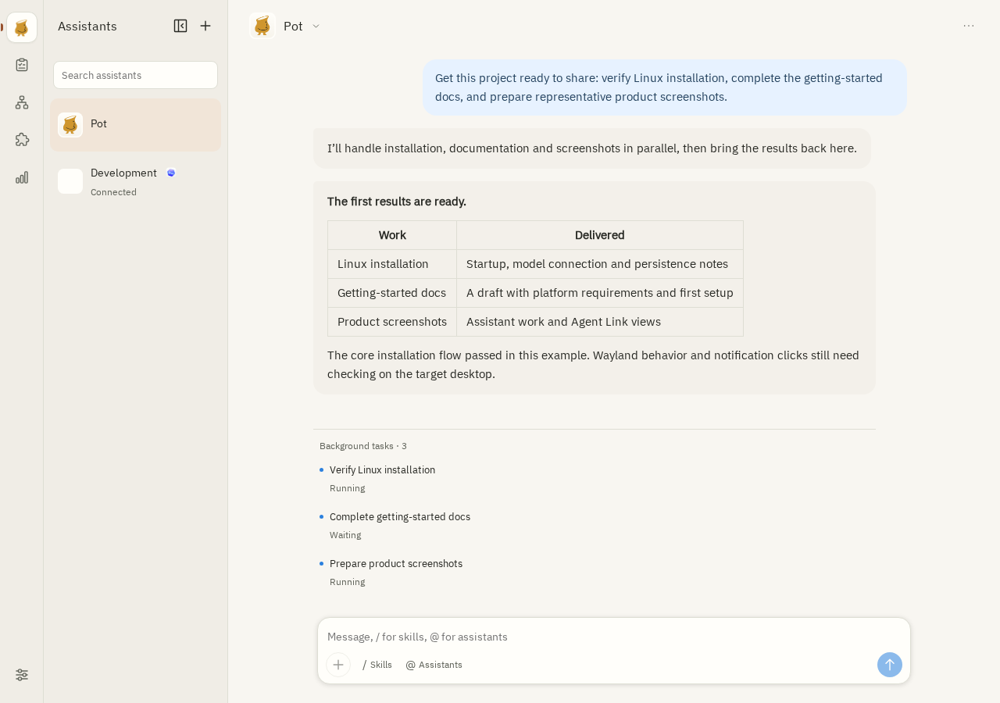
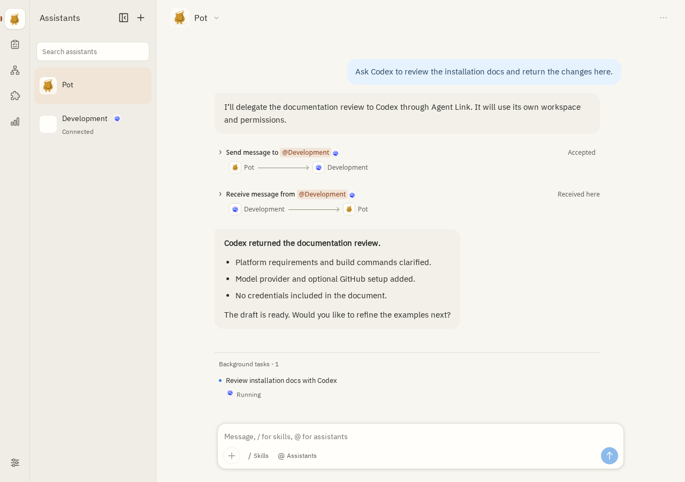

<p align="center">
  
</p>
<h1 align="center">Pot</h1>
<p align="center"><strong>帮你调度和协同 Coding Agents 的开源 AI 助手，让你不再疲于微观管理。</strong></p>

<p align="center">
  <a href="README.md">English</a> · <a href="README_zh.md">简体中文</a>
</p>

[官网](https://pot.jjylab.com) · [为什么做 Pot？](#为什么做-pot) · [快速开始](#安装) · [Agent Link 跨端连接](#agent-link-你的多-agent-协作中枢) · [文档中心](docs/README.md) · [发行版本](https://github.com/jjyr/pot/releases)

Pot 将对话形式的目标转化为真正交付的成果。你不再需要频繁切换碎片化的窗口、反复对齐琐碎细节，Pot 作为一个持久运行的助手，负责拆解并分发后台任务、在跨机器间协同外部 Agents，只在真正需要高层决策时才打扰你。

## 为什么做 Pot？

使用 Coding Agent 本应带来 10 倍效率，但很多开发者的真实感受却是**身心俱疲**——整个下午都在给 AI 当全职保姆：跨会话反复叮嘱工作流规范、为细节反复对齐、逐行审查代码。

Pot 的设计基于一个核心原则：**人的精力应保留在架构与决策层面，重复的琐事交给助手。**

- **是持久助手，不只是单次 Agent**：助手拥有长期维护的会话，能自然沉淀你的工作流习惯和偏好，上下文压缩后也不会失忆。
- **目标委派与后台执行**：给助手一个目标，它自动拆解出后台任务、跟进进度，并将最终结果汇聚回主会话。
- **跨机器的协作中枢**：可以在 Linux 服务器上无头（Headless）运行 Pot，手机浏览器随时查看调度，并将具体的代码开发任务委派给 Mac 本地跑着的 Codex。

👉 *深入阅读设计背后的思考：* **[用 Agent 编程，但我为什么这么累？](https://jjylab.com/posts/why-agent-coding-is-exhausting/)**

## 从一段对话，到交付成果

> “帮我把这个项目准备好以便分享：验证 Linux 环境安装、补齐入门指引文档，并生成几张具有代表性的产品截图。”

Pot 会把这个目标拆解为安装验证、文档撰写和截图生成的后台任务。所有成果都会汇总回当前对话：包含未完成项的验收说明、文档草稿、以及可直接预览的图片。在对话中继续跟进迭代即可：“把移动端截图调大一些；文档保留这个版本。”

[](docs/images/conversation-tasks.png)

*Pot 的实际产品界面示例（点击查看大图）*

## Agent Link: 你的多 Agent 协作中枢

现代 AI 开发往往不局限于单一工具或单台电脑。**Agent Link** 负责把你在不同电脑、不同平台上的 Coding Agents 和各类自动化 Bot 直接连通起来，让它们能跨机器互相派活与协作——同时保留每个 Agent 各自的模型、密钥凭证与独立工作区。

- **跨电脑协同**：云端服务器上运行的 Pot，可与你本地主力开发机无缝组网。
- **独立任务执行**：委派的任务在独立、持久的线程中运行，绝不阻塞当前活跃对话。
- **生态接入情况**：
  - **Codex**：**已支持**。通过专用 Adapter 提供双向任务委派与 Code Review 流程。
  - **Claude**：*即将推出*
  - **Grok**：*即将推出*
  - **Antigravity**：*即将推出*

[](docs/images/agent-link.png)

*通过 Agent Link 与外部 Agent 通信的实际界面（点击查看大图）*

## 安装

你可以直接将以下提示词发给你本地的 AI Agent，让它帮你自动安装配置 Pot：

```text
Read https://github.com/jjyr/pot/blob/main/docs/install-with-agent.md and help me install and configure Pot on this computer.
```

[使用 Agent 安装指南](docs/install-with-agent.md) 能引导 Agent 检查当前环境并完成首次配置。如果你选择手动安装：

| 渠道 | 下载 / 安装方式 | 适用平台 |
|---|---|---|
| macOS App (Homebrew) | 执行下方命令；[Tap 说明](docs/releases.md#homebrew-generation) | Apple Silicon, macOS 26+；[首次运行说明](docs/desktop-installation.md#macos) |
| macOS CLI (Homebrew) | 添加下方 Tap 后执行 `brew install jjyr/pot/pot-cli` | Apple Silicon, macOS 26+；[CLI 安装指南](docs/desktop-installation.md#macos-cli) |
| Linux 桌面端 · 实验性 | [下载 .deb](https://github.com/jjyr/pot/releases) — 选择 `pot-desktop_VERSION_linux_amd64.deb` | Debian / Ubuntu amd64；[系统依赖要求](docs/desktop-installation.md#linux-experimental) |
| Web UI (Docker) | [查看 Docker 镜像](https://github.com/users/jjyr/packages/container/package/pot) · `ghcr.io/jjyr/pot` | Linux amd64 / arm64；[容器运行说明](docs/docker.md) |
| Web UI (Server) | [下载 Web UI / Server](https://github.com/jjyr/pot/releases) — 选择 `pot-VERSION-linux-ARCH.tar.gz` | glibc Linux amd64 / arm64；[服务端配置与运行](docs/deployment.md) |

```sh
brew tap jjyr/pot https://github.com/jjyr/pot.git
brew install --cask jjyr/pot/pot
```

如果你需要不依赖图形界面的独立无头 CLI：

```sh
brew install jjyr/pot/pot-cli
pot-cli --version
# 通过 Homebrew 升级 CLI：
brew upgrade jjyr/pot/pot-cli
```

`pot-cli` 包含独立的 Node 与运行所需资源，完全无 GUI 依赖。如果与桌面 App 同时运行，请使用独立的数据目录，详见 [CLI 安装指南](docs/desktop-installation.md#macos-cli)。

*当前 macOS 预览版本通过 Homebrew 提供，首次启动可能需要允许 Gatekeeper 安全确认，详见 [首次启动指引](docs/desktop-installation.md#macos)。目前暂不支持 Windows。*

## 首次运行

### 桌面客户端

启动 Pot，点击 **Add assistant** 连接模型供应商、另一台 Pot 节点或 Codex。试着发送：“调研这个项目并给出三个改进建议。”

若要使用 Agent Link，在另一端打开 **Add Agent** 并粘贴连接凭证即可。详见 [Agent Link 文档](docs/agent-links.md) 或 [Codex 接入说明](integrations/codex/README.md)。

### Linux 服务器 / Web UI

确保已安装 Git 和 [mise](https://mise.jdx.dev/getting-started.html)：

```sh
git clone https://github.com/jjyr/pot.git
cd pot
mise install
mise run prepare
mise run build:go
.local/pot/bin/pot serve -root "$HOME/.pot-node" -ui 127.0.0.1:17703
```

保持服务运行。在另一个终端窗口中获取登录 Token：

```sh
.local/pot/bin/pot access -root "$HOME/.pot-node" token
```

浏览器打开 <http://127.0.0.1:17703>，使用 Token 登录即可开始添加助手。如果是远程服务器，可先在本地终端进行端口映射：

```sh
ssh -L 17703:127.0.0.1:17703 user@your-server
```

## 连接其他 Assistants

Agent Link 目前已完整支持 Pot 与 Pot 互联，以及连接 Codex。

### Codex

**已完整支持。** 在运行 Codex 的电脑上，将以下提示词发给你的 Agent：

```text
Read https://github.com/jjyr/pot/blob/main/docs/connect-with-agent.md and help me connect Codex to Pot on this computer.
```

或查阅完整的 [Codex 手动接入指引](integrations/codex/README.md#install-and-connect)。

### Claude / Grok / Antigravity

即将推出适配支持。

## 更多用法

你可以针对不同目标创建专属助手，跨任务保留工作区与文件，配置 [定时自动化任务](docs/scheduled-tasks.md)，并通过 [插件、MCP 服务与 Skills](docs/plugins.md) 扩展能力。还可以选择性开启 [GitHub 个人通知集成](docs/plugins.md#github-notifications)，让项目动态直接流入助手会话中。

详细指南请参阅 [文档中心](docs/README.md)。

遵循 [MIT 开源协议](LICENSE)。
