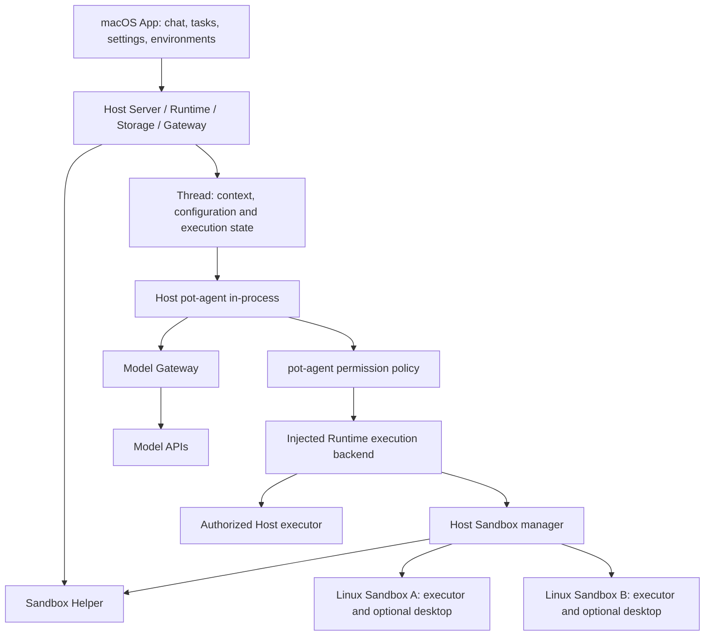

# Current architecture

Updated: 2026-10-09. See [Local Agents and managed Sandboxes](agent-sandbox-design.md) for authority and lifecycle contracts.

The [Sandbox provider redesign](sandbox-providers.md) has extracted Linux support and implemented prepared-instance macOS integration (awaiting real VM qualification), with Android/iOS deferred, and inserts a dedicated Sandbox Manager between Runtime and Providers. Runtime retains product/task authority; Manager owns environment coordination and state. Separate Provider crates implement `pot-sandbox` contracts and are registered by App/Server assembly without reverse Cargo dependencies. The diagram and implementation details below describe current Linux behavior, not that target architecture.

## Placement and entry points

| Component | Responsibility | Entry points |
|---|---|---|
| App / Swift bridge | Persistent chat, immutable task environments, settings, environment selector and optional noVNC desktop | `crates/app/src/`, `crates/app/swift/` |
| Helper | Start Host Server; separate VM instances and mounts; graceful product/VM shutdown | `helper/Sources/PotHelper/main.swift` |
| Server / Runtime | HTTP/SSE/MCP/PTY hosting, authoritative messages, scheduling, sessions, cancellations | `crates/server/src/`, `crates/runtime/src/` |
| Sandbox manager | Inventory, selection, lifecycle serialization, scoped execution, leases, durable operation receipts/quarantine | `crates/sandbox/src/manager.rs`; Runtime authorization bridge in `crates/runtime/src/sandbox.rs` |
| Agent | Host in-process pot-agent; injected execution backend | `crates/agent/src/lib.rs` |
| Gateway / Storage | Provider protocol/allowance enforcement; Host SQLite threads, contexts and usage | `crates/gateway/src/`, `crates/storage/src/` |
| Guest executor | Authenticated execution-only HTTP service, unprivileged file/command tools, cgroup cancellation | `crates/sandbox-images/linux/default/executor.py`, `crates/tool-executor/src/`, `crates/sandbox-images/linux/default/sandbox.sh` |

The App embeds the Host backend and dispatches local UI requests in memory. Standalone `pot serve` hosts the same backend with OS-protected CLI management. The Helper is started in Sandbox-only mode by these hosts. Internal `runtime.json` carries authenticated tool/model integration metadata, not App endpoint discovery. A Sandbox starts on explicit request or first authorized environment tool. The main Agent selects among up to 16 Linux definitions and can pass an explicit target to an environment tool. Workers receive exec_command, write_stdin and apply_patch, a lane token and one persistent assignment; Runtime rejects worker management and switching Sandboxes.

pot-agent owns [permission policy](permissions.md) and bounded
[tool composition](tool-composition.md); Runtime supplies owner services and
execution routing. Main defaults to Host and Workers to their assigned Sandbox.
Pinned plugins use the same tool admission path and environment-specific Node runners; [computer use](computer-use.md) follows Host/Sandbox permissions. No Sandbox failure causes Host fallback.

Model inference location is independent: Agent processes are local, model APIs can be remote or an explicitly configured loopback endpoint.

## Persistence and lifecycle

Host state lives in `root/product`: SQLite messages/usage, tasks/schedules, Thread contexts and bearer endpoint. `sandboxes.json` holds definitions and main selection; `sandbox-operations.json` holds execution outcomes requiring reconciliation. Each Sandbox mounts only `root/sandboxes/ID/workspace` at `/data`. Environment tool output is bounded and currently delivered with each execution/poll response; `yield_time_ms` plus `write_stdin` enables progress polling. Guest artifacts are `/data/workspace`; task artifacts are `/data/workspace/tasks/TASK_ID`. Executor credentials remain in the Host Sandbox directory outside the mounted workspace and enter the root guest process only at startup. The guest removes the credential from child environments; its operation ledger and temporary output use root-private `/run/pot-executor`, outside virtiofs. The guest receives no provider credentials, Thread context, Host endpoint token or Helper socket.

Main chat and tasks use the same Thread representation. Tasks keep independent configuration snapshots and immutable `sandbox_id`. Schedules resolve and save their environment when configured. A worker turn holds an environment lease, and dispatched tools hold operation leases. Stop/delete rejects active task/operation leases and unknown outcomes. Task cancellation settles its remote processes without stopping the shared VM. A cgroup contains background and `setsid` descendants. Completed execution receipts replay the saved result, while conflicting/incomplete requests never reexecute. Client disconnects do not discard cleanup.

Host restart preserves Thread configuration and context and artifacts, marks interrupted turns visibly and quarantines unsettled executions. Main-only `recover` confirms executor cancellation or VM termination; it never repeats a command. Definitions referenced by tasks or schedules cannot be deleted. Deleted identities cannot be reused, and deletion retains workspace artifacts. Desktop is optional and explicitly started; stopping its environment closes it along with the guest.

Multiple tasks sharing a VM are cooperative users of the same guest account. Workspace directories are organization, not task-level filesystem isolation. macOS/Windows provider qualification are outside this increment.

## Tasks, profiles and usage

Background concurrency defaults to 8, with profile/provider limits, FIFO runnable queues, independent main chat and serial turns within each lane. Follow-ups persist; workers cannot recursively delegate. Completion reports are durable and summarized by a read-only main turn. Schedules own time zones, occurrence deduplication, missed-run policy and overlap prevention.

Thread configuration and Agent context live directly in the owner SQLite Store. Runtime calls the concrete pot-agent executor; there is no Engine selector, Binding history, native session mapping or Driver host/session layer. Agent status contains only model, phase and detail; external-engine installation/version/auth-method states are removed. Profiles are reusable configuration templates: creation copies a resolved snapshot into the Thread. Explicit configuration changes apply atomically at a safe turn boundary without replacing context or writing a handoff summary. Owner/generation/turn checks reject stale execution updates. Existing tasks keep their snapshots when global profiles change. Model requests reserve allowance before networking, including tool continuations and failures. pot-agent uses a gateway token rather than provider secrets; product execution limits remain separate from credentials.

Runtime exposes HTTP/SSE; App uses cached snapshots and paginated polling with stale-result rejection. SQLite uses DELETE journal and synchronous=EXTRA. Query live state through the API. [Runtime contract](../crates/runtime/README.md) documents the API, and [validation](validation/host-pot-agent-20261006.md) records current acceptance.
