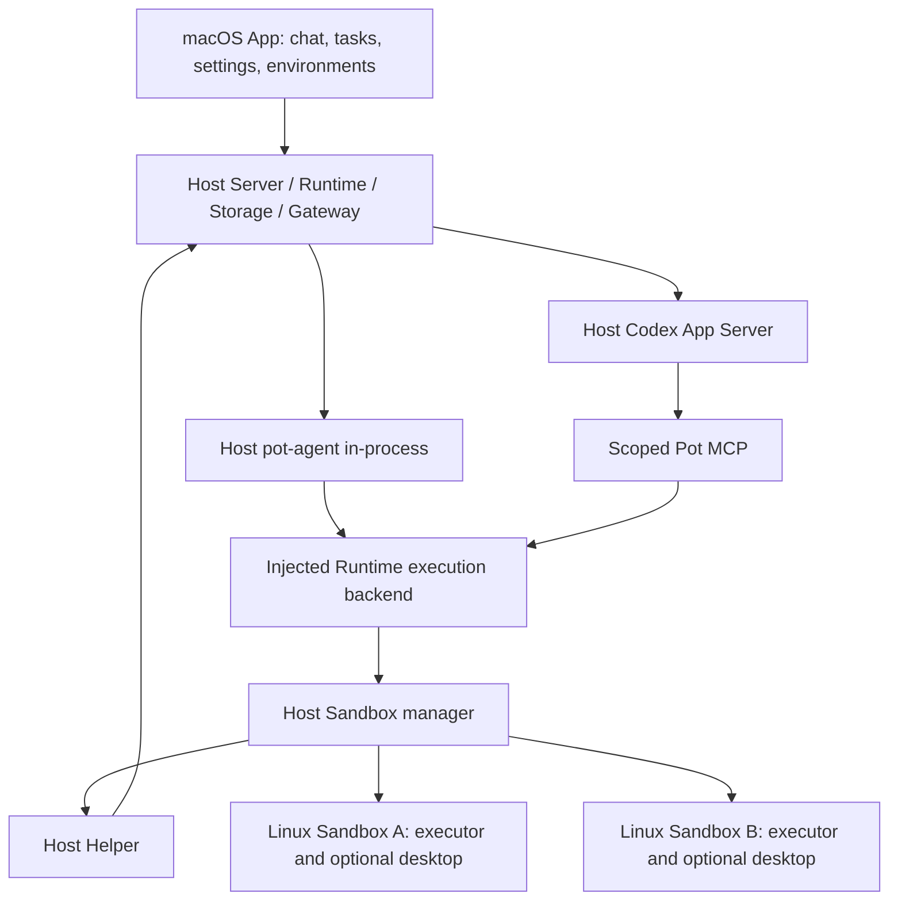

# Current architecture

Updated: 2026-10-06. See [Local Agents and managed Sandboxes](agent-sandbox-design.md) for authority and lifecycle contracts.

## Placement and entry points

| Component | Responsibility | Entry points |
|---|---|---|
| App / Swift bridge | Persistent chat, immutable task environments, settings, environment selector and optional noVNC desktop | `app/src/`, `app/swift/` |
| Helper | Start Host Server; separate VM instances and mounts; graceful product/VM shutdown | `helper/Sources/PotHelper/main.swift` |
| Server / Runtime | HTTP/SSE/MCP/PTY hosting, authoritative messages, scheduling, sessions, cancellations | `server/src/`, `runtime/src/` |
| Sandbox manager | Inventory, selection, lifecycle serialization, scoped execution, leases, durable operation receipts/quarantine | `runtime/src/sandbox.rs` |
| Agent / Driver | Host in-process pot-agent and Codex App Server; injected execution backend / MCP | `agent/src/lib.rs`, `driver/src/codex.rs` |
| Gateway / Storage | Provider protocol/allowance enforcement; Host SQLite and native session bindings | `gateway/src/`, `storage/src/` |
| Guest executor | Authenticated execution-only HTTP service, unprivileged file/command tools, cgroup cancellation | `image/executor.py`, `tool-executor/src/`, `image/sandbox.sh` |

The Helper starts the Host backend without booting a VM. The App discovers `root/product/runtime.json` on loopback. A Sandbox starts on explicit request or first authorized environment tool. The main Agent selects among up to 16 Linux definitions and can pass an explicit target to an environment tool. Workers receive exec_command, write_stdin and apply_patch, a lane token and one persistent assignment; Runtime rejects management and target overrides.

pot-agent receives a Runtime ToolExecutor with no Host fallback. One shared schema and argument validator covers the three environment tools. The guest runner retains process sessions inside a root-owned per-turn cgroup; Runtime binds opaque session IDs to owner, turn, Sandbox and VM generation. Codex has native shell, patch, image, code execution, apps, plugins, subagent and inherited MCP capabilities disabled; its environment list is empty and Pot MCP supplies Sandbox operations. Both Agents use a private Host working directory. Host tool execution has no fallback.

Model inference location is independent: Agent processes are local, model APIs can be remote or an explicitly configured loopback endpoint.

## Persistence and lifecycle

Host state lives in `root/product`: SQLite messages/usage, tasks/schedules, private Agent sessions and bearer endpoint. `sandboxes.json` holds definitions and main selection; `sandbox-operations.json` holds execution outcomes requiring reconciliation. Each Sandbox mounts only `root/sandboxes/ID/workspace` at `/data`. Environment tool output is bounded and currently delivered with each execution/poll response; `yield_time_ms` plus `write_stdin` enables progress polling. Guest artifacts are `/data/workspace`; task artifacts are `/data/workspace/tasks/TASK_ID`. Executor credentials remain in the Host Sandbox directory outside the mounted workspace and enter the root guest process only at startup. The guest removes the credential from child environments; its operation ledger and temporary output use root-private `/run/pot-executor`, outside virtiofs. The guest receives no provider credentials, Agent session, Host endpoint token or Helper socket.

Tasks keep independent Agent/profile snapshots and immutable `sandbox_id`. Schedules resolve and save their environment when configured. A worker turn holds an environment lease, and dispatched tools hold operation leases. Stop/delete rejects active task/operation leases and unknown outcomes. Task cancellation settles its remote processes without stopping the shared VM. A cgroup contains background and `setsid` descendants. Completed execution receipts replay the saved result, while conflicting/incomplete requests never reexecute. Client disconnects do not discard cleanup.

Host restart preserves CLI bindings and artifacts, marks interrupted turns visibly and quarantines unsettled executions. Main-only `recover` confirms executor cancellation or VM termination; it never repeats a command. Definitions referenced by tasks or schedules cannot be deleted. Deleted identities cannot be reused, and deletion retains workspace artifacts. Desktop is optional and explicitly started; stopping its environment closes it along with the guest.

Multiple tasks sharing a VM are cooperative users of the same guest account. Workspace directories are organization, not task-level filesystem isolation. macOS/Windows providers and direct Host tools are outside this increment.

## Tasks, profiles and usage

Background concurrency defaults to 5, with profile/provider limits, FIFO runnable queues, independent main chat and serial turns within each lane. Follow-ups persist; workers cannot recursively delegate. Completion reports are durable and summarized by a read-only main turn. Schedules own time zones, occurrence deduplication, missed-run policy and overlap prevention.

`agent.bindings.v1` holds resolved immutable Agent specifications, checksums, epochs and native refs. Profile changes use durable migration; existing tasks keep their bindings. Model requests reserve allowance before networking, including tool continuations and failures. pot-agent uses a gateway token rather than provider secrets; Codex retains its native Host authorization home. Product execution limits remain separate from credentials.

Runtime exposes HTTP/SSE; App uses cached snapshots and paginated polling with stale-result rejection. SQLite uses DELETE journal and synchronous=EXTRA. Query live state through the API. [Runtime contract](../runtime/README.md) documents the API, and [validation](validation/host-pot-agent-20261006.md) records current acceptance.
