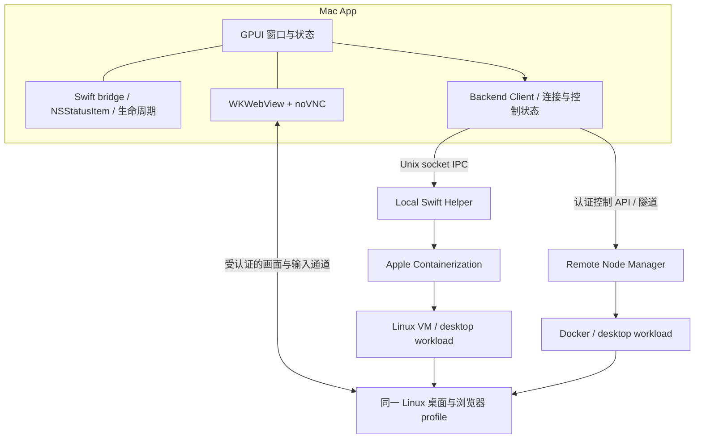

# pot 架构概览

更新：2026-10-03。详细产品约束见 [产品设计](product-design.md)，当前实施顺序见 [POC 计划](poc-plan.md)。

pot 有三条需要实证的技术边界：GPUI 与 macOS 原生 UI 共存、桌面画面/输入从远端进入原生窗口、App 管理本地 Swift helper 和 VM。当前先用可操作的桌面切片确认它们。

图中本地与远端是两种 backend 选择，不是同时连接同一桌面实例。切换 backend 时环境标识明确，不隐式迁移任务或浏览器。

## 客户端与原生边界

- GPUI 拥有主窗口、产品状态和主事件循环；Swift bridge 操作同一个 NSApplication/NSWindow，不启动第二套 App 主循环。
- Swift bridge 包装 tray、窗口显隐、激活/焦点与 WKWebView。所有 AppKit/WebKit 操作回到主线程，生命周期和 delegate 持有关系明确。
- Rust 与 Swift 之间采用小型 C ABI。传值和回调的内存所有权须显式定义；PoC 验证销毁后回调不会访问旧窗口。
- Viewer 采用 WKWebView + noVNC（远端 TigerVNC）。P2/P3 已实测基本键鼠、中文 Clipboard、断线重连与接管/交回，决定保留；远端中文直输/原生 IME 与 resize 适配仍是针对性验收项，Clipboard 是当前明确的中文 fallback。
- 关闭主窗口保持菜单栏可用；显式 Quit 的 helper/VM 处置必须有确定语义。POC 先定义 Quit 停止本次自有 helper/VM，后续长期后台模式另行设计。

## 远程 Docker 桌面

远程主机需要 Docker。P2 采用最少组件：headed Chromium + TigerVNC（X 服务器与 VNC 合一）+ fluxbox + websockify/noVNC；最初的 Xvfb + x11vnc 在中文 Clipboard 上失败，已替换。固定 base digest、apt snapshot 与 noVNC 归档，按构建出的 image ID 启动；workspace 与 profile 使用独立 volume；Chromium 保留自身 sandbox（专用 seccomp profile，不用 `--no-sandbox`）。

第一次通过 SSH tunnel 或等价受认证私有通道验证远程连接：远端 VNC/WebSocket 只监听 loopback，Mac 建立隧道后 viewer 连本地入口。此阶段不用公开裸 VNC/CDP，不需要自建公网认证平台。若产品需要直接 WSS，再单独验证证书、token、origin 与撤销。

自动化与 viewer 使用相同 DISPLAY、浏览器进程和 profile。接管状态与输入归属由后端决定。POC 首先验证 broker 管理的两个输入来源可交接；任意 shell/CDP 绕过的完整权限保护属于进一步实现，证据不能混用。

## 本地运行时

Swift helper 是独立进程，链接固定 Containerization 版本。GPUI 经 Unix domain socket 调用 prepare/start/status/stop，订阅 ready/error/exited 等事件。VM handle、guest 资源和清理由 helper 拥有。

首个可运行 helper 可用用户进程，由 App 拉起；不要在尚未证明需要时引入 privileged helper。若真实权限要求更高，再用证据决定安装与授权路径。

应用包必须能定位 helper、动态库、kernel/init 描述及首次下载资源；不能依赖开发机 `/tmp` 或仓库绝对路径。源码编译成功与独立 `.app` 可启动是两个验收点。

## 后续 Agent/Runtime

首期引擎为 Codex、Claude、Pi、OpenCode 和 Google Antigravity，各自 adapter 接入统一产品控制协议。主助手默认 Pot；引擎不会产生新的人格。

长期身份/任务/会话机制以 OpenClaw/Hermes 研究为参考，产品状态与原生 thread/context 分离。现有小型 SQLite Runtime 仅作为规则和恢复实验；当前不以它为中心继续堆功能，也不据此冻结生产语言或数据库接口。

## 当前已知与未知

P0–P4 最小切片已实施，结论均按报告限定为有限通过：真实菜单栏操作/原生输入、远程 Docker 在 WKWebView 内操作与接管/交回、自有 Swift helper 管理真实 VM、移动后的 App 独立启动与故障清理。见 [POC 进度](poc-plan.md#10-执行记录)、[P3](validation/integrated-desktop.md)、[P4](validation/native-helper-bundle.md)。

仍未完成：远端完整 IME、弱网/性能矩阵、恶意 shell/CDP 全通道隔离、冷安装与公开分发验收。本地 Chromium 正常退出仍留 Crashed profile 标记，需在产品化前解决。保留当前技术路线，不把最小 POC 等同产品完成；进入产品骨架前的门槛见 [下一阶段](poc-plan.md#11-下一阶段)。
