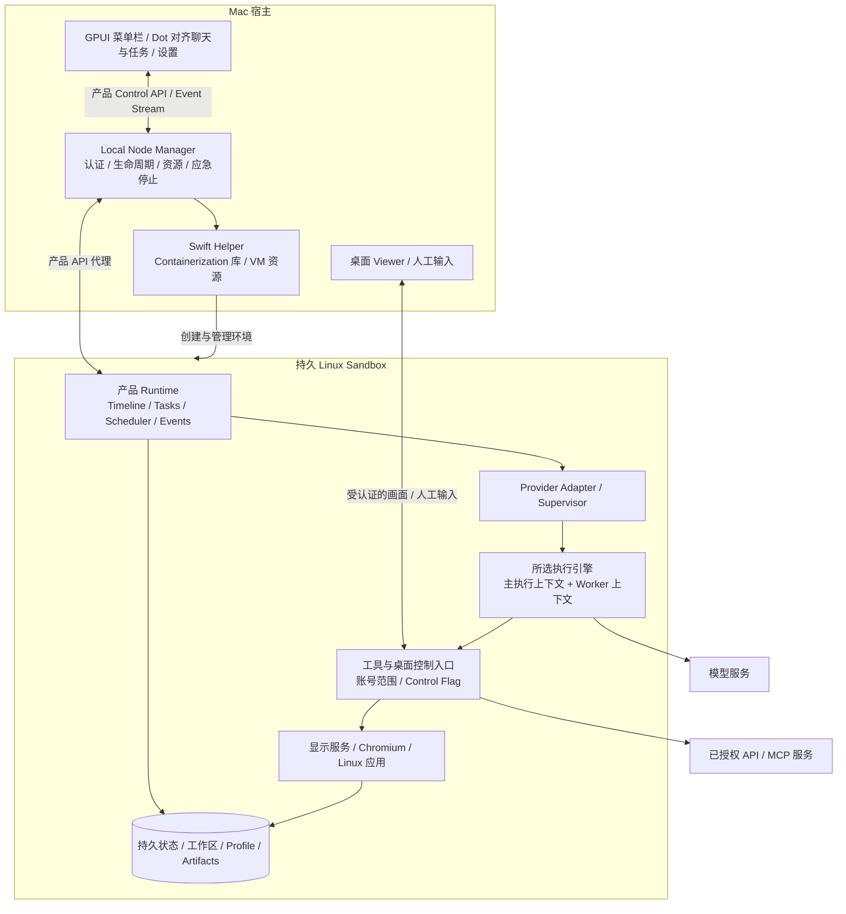

---
tags:
  - Product
  - Agent
  - Architecture
---

# pot：本地个人 Agent 工作环境产品设计

版本：v0.12，项目初始化与 POC 优先级整理  
更新日期：2026-10-03  
状态：基础技术 POC 已执行，结果见 [pot产品架构研究与POC验证](validation/baseline-report.md)；本文描述目标产品，不宣称完整产品、模型任务或发行安装包已验收。  
阅读顺序：第 1–3 节看产品与用户体验，第 4–8 节看实现架构，第 9–10 节看首版范围和未决项。

## 1. 产品定义与设计边界

### 1.1 一句话定义

**pot 是一个安装在 Mac 上、从菜单栏进入的长期个人助手。它在持久 Linux 沙箱中处理工作，协调后台任务，记住必要的偏好和背景；用户通过主聊天交办、追问和接收结果，并能随时查看、接管同一个工作桌面。**

**交互以 ChatGPT Dot 为基线：除执行引擎 Setup 与沙箱设置外，聊天引导、任务入口、活动/产物、计划、服务连接、桌面接管、动作 review 和记忆控制均按 Dot 的公开交互与实机体验对齐。**本地部署和引擎差异由架构吸收，不作为另造交互的理由；不推断或复制闭源内部实现。

本地运行的是 GUI、环境管理、Agent runtime 和工具。模型推理由所选 provider 提供，可能调用云服务；“本地工作环境”不等于默认离线或数据永不离开机器。

### 1.2 解决什么问题

用户希望交代目标后，助手能继续推进、保存工作、报告结果，并在下次交谈时接上已有背景。现在这些能力经常分散在聊天、终端、浏览器、服务授权和自动化脚本中；任务的真实状态也容易只存在于一段对话或一个进程里。

pot 把这些能力放进一个可见、可接管、可恢复的个人工作环境。代码修改是其中一种工作，资料研究、文件整理、网页操作和已连接服务上的工作同样属于产品目标。

### 1.3 已确定的产品约束

| 维度 | 当前需求基线 |
|---|---|
| 用户入口 | Mac 菜单栏；GUI 方向为 GPUI |
| 首次旅程 | 先 setup 执行引擎与认证 → 进入主聊天 → Agent 询问命名等个性化问题；默认助手名 Pot |
| 初期引擎 | codex、claude、pi、opencode、agy；用户先选用哪个，具体接入与能力逐项验证 |
| 助手关系 | 一个长期主助手；内部 tasks/workers 无独立人格 |
| 聊天结构 | 按 Dot 的主聊天与任务 threads 交互组织；任务可独立查看和追加指导，不引入持久项目助手人格 |
| 工作位置 | 主 Agent、provider、工具、浏览器及工作状态放在持久 Linux GUI 沙箱中 |
| 自主执行与 review | 普通工具无需逐条弹窗；影响账号/分享信息等动作按 Dot action review 与规则交互处理，账号与 scope 独立管理 |
| 人工接管 | 查看不等于接管；后端 flag 结合 controller 独立权限域禁用 Agent 输入，明确交回后继续；不能只靠模型遵守 |
| 本地部署 | 产品自带 container library 及必要资源，用户无需先装 Docker Desktop |
| 远程部署 | 用户自行安装 Docker，产品另提供远程 Node Manager；GUI 与后端可分离 |
| 扩展方向 | 一个 GUI 可连接多个节点；切换执行目标不创建新人格，不自动迁移任务 |
| 交互例外 | 执行引擎 Setup（codex、claude、pi、opencode、agy）与可配置沙箱；其余按 Dot 对齐 |
| 当前排除 | 持久项目 Agent、Agent pin/archive、环境迁移、跨助手通信 |

**状态约定**：“已定”指已有明确需求；“建议”指本稿推荐实施方式；“待验证”指已有依据但尚无原型证据；“待决策”指仍有影响产品承诺的选择。建议不替代已定约束。

### 1.4 与参照产品的关系

最新交互决定替代 v0.5–v0.7 的“只保留唯一主聊天、任务无独立聊天”收敛方案，也结束“是否对齐 Dot action review”的产品选择题。Dot 支持的主/任务对话、Activity/Outputs、Scheduled、追加指导、连接与接管等行为都作为目标，不再增加 pot 自定义简化。

| 层次 | 对齐原则 |
|---|---|
| 交互 | 除 Agent Setup 与沙箱设置外，以 Dot 为准；入口、文案、状态反馈和控制语义需逐项核对 |
| 产品标识 | 名称使用 pot，助手默认 Pot；不复制 Dot 品牌标识 |
| 技术实现 | GPUI、Linux Sandbox、多引擎 adapter 和本地/远程后端按 pot 架构实现 |
| 客观部署限制 | 本地后端依赖 Mac 在线；离线/故障必须真实显示，不能假装拥有托管电脑能力 |
| 未核实细节 | 已有文档能支持语义基线；具体布局、动效和完整流程需 Dot 实机核对，不凭空补成官方行为 |

多节点管理等尚未首发的设计不应扩张当前主要交互；必要配置归入沙箱设置。Dot 某项能力无法由所选引擎实现时，应标记不支持/未就绪，而非用不同交互掩盖。

Codex 登录不意味着继承 ChatGPT memory、宿主浏览器会话或任意服务账号权限。

## 2. 用户从安装到使用的效果

以下是设计目标，不是已经上线的功能说明。

### 2.1 安装、Setup 与聊天内引导

**首次流程：安装 → Setup 选用哪个执行引擎 → 完成环境准备与必要认证 → 进入主聊天 → Agent 询问命名等问题 → 开始工作。**

产品名为 pot；用户面对的主助手默认叫 **Pot**。执行引擎选择与助手命名是不同步骤：选择 codex/claude 等决定背后的执行实现，不创建对应的独立人格。

| 阶段 | 用户看到与操作 | 产品在背后完成 | 成功后的效果 |
|---|---|---|---|
| 安装 | 下载并安装 Mac App；打开 pot | 检查 CPU 架构、系统版本、磁盘与必要组件 | 菜单栏出现入口；不要求用户写容器命令 |
| Setup 选择引擎 | 在 codex、claude、pi、opencode、agy 中选择要使用的引擎 | 保存选择，准备匹配版本与安装路径 | 用户知道 Pot 将通过哪个引擎工作 |
| 环境与认证 | 查看准备进度，按所选引擎要求登录或配置凭据/模型 | 准备 Linux 环境与所选引擎，验证认证、模型响应和低风险工具 | 环境及引擎就绪，Setup 完成后进入主聊天 |
| 聊天内引导 | Pot 主动打招呼，询问名字等个性化问题 | 保存稳定 agent ID、名称和用户明确偏好 | 用户可接受默认 Pot 或通过对话改名，在同一聊天建立协作习惯 |
| 首次工作 | 在主聊天直接提出需求，可附文件 | 创建任务、选择相关上下文、调用工具 | 看到任务卡、进度与可打开的结果 |

Setup 完成后按 Dot 的聊天内引导询问命名等个性化问题，助手默认名为 Pot。不另造安装个性化问卷；命名询问是用户已定需求；Dot 官方文档尚未证明固定询问顺序，具体问题、跳过/继续方式和开场文案需实机核对。用户明确提供的名字与偏好持久保存。

环境准备可以与引擎选择/认证流程并行。Setup 未就绪时显示具体进度、错误和重试入口，不伪装为可工作的聊天；失败后保留引擎选择与已完成步骤。聊天内引导进度也需持久化，重开不重复询问已回答问题。

**本地候选平台门槛**：采用现有 Apple Containerization 路线时，研究基线是 Apple silicon + macOS 26。Intel/旧 macOS 的 fallback 尚未选定，应在安装前说明支持范围。

无需先连接 GitHub/Gmail、创建项目或完成示例任务。认证方式和模型配置随引擎不同；模型额度、费用及账号可用性不预设由产品承担。后续在设置中更换引擎，保留 Pot 的身份和主聊天，执行上下文按 adapter 能力恢复或重建，不承诺原生 thread 能跨引擎迁移。

### 2.2 日常交办与并行工作

用户说：“把这几份资料整理成一份比较报告。”主助手确认目标与必要约束，建立任务卡，开始在沙箱里读文件、查资料、生成报告。用户可以打开产物，也可以查看来源与执行证据。

任务执行中，用户可以继续说：“报告加上部署成本。另外帮我整理这个目录。”引用报告任务的指导进入原任务；目录整理形成另一任务。两项工作有各自上下文和状态，用户可从主聊天或对应任务 thread 查看进展、追加指导和接收结果，入口与路由按 Dot 对齐。

主助手汇总重要进度，详细工具输出折叠。完成、失败、阻塞和需要用户决定时通知；普通心跳不刷屏。“运行结束”和“用户目标达成”分开判断，部分完成要明确列出剩余工作。

### 2.3 连接服务与处理登录

用户从设置或聊天发起 GitHub 等服务连接，选择账号和授权范围。连接成功后，主助手能在该范围内工作；撤销连接后不能继续使用原能力。

需要网页登录、2FA 或验证码时，主聊天给出“打开桌面并接管”入口。用户在沙箱浏览器中登录，明确交回，Agent 重新观察后继续。沙箱浏览器拥有自己的 profile，不继承 Mac 浏览器登录；密码不应通过聊天输入。

GitHub 建议作为第一个可选服务闭环。Gmail 需要另外验证 OAuth scopes、公开分发审核和撤销行为，不承诺与 GitHub 同期完成。

### 2.4 查看、接管与交回

| 用户动作 | 看到的效果 | 工作如何继续 |
|---|---|---|
| 查看桌面 | 当前环境里 Agent 正在使用的同一个桌面与浏览器 | Agent 继续，viewer 不发送用户输入 |
| 点击接管 | 先显示交接中，后端确认后显示“你正在控制” | 当前环境的 Agent 桌面/浏览器输入受阻 |
| 人工操作 | 用户移动鼠标、输入、登录或修改页面 | 非桌面计算、已授权 API 任务可继续；接管不代表全局暂停 |
| 点击交回 | 控制状态恢复为 Agent 可操作 | Agent 重新读画面/DOM，不盲用旧坐标 |
| 接管时断线 | 显示断线/状态未知，重连读取后端状态 | 建议保持人工控制，禁止静默抢回 |

建议人工控制期间暂停向模型上传截图/视觉观察，另设观察状态；输入控制与观察隐私是两种权限。

### 2.5 关闭窗口、重启与定时工作

关闭聊天窗口后，菜单栏和后端仍可运行，任务继续。退出整个产品时应明确说明后台是否继续，不能把“退出 GUI”与“停止后端”混为一谈。

Mac 休眠、关机或后端停止时，本地任务和计划不能继续执行。再次启动后恢复同一助手、聊天记录、工作区、浏览器 profile 和任务记录；执行中的进程不保证原样恢复。无法核实的动作标记为“待核实”，先查真实结果再继续。

用户说：“每周一北京时间上午九点检查这个报告来源，只在有重要变化时告诉我。”系统保存明确的计划、时区、指令和通知条件，并在 Scheduled 中展示。只连接来源或把这句话写入 memory 不代表已经创建计划。

建议本地错过计划时按配置补跑或跳过，显示错过情况；不连续补发一串旧通知。远程在线节点可以承载持续运行，但不会自动转移本地任务。

### 2.6 长期使用的体验

用户说“以后默认用中文”“这条偏好改一下”“忘记那件事”，助手应在真实持久提交后确认；后续任务按最新版本使用相关背景。聊天可以持续，内部执行上下文可以压缩、恢复或轮换，用户不用管理 provider thread。

遗忘要说明处理范围。聊天历史、产品记忆、provider 副本、浏览器凭据和备份是不同资产，删除其中一种不自动删除其他数据。

**最终用户感受到的连续性**：再次点开菜单栏，面对的仍是同一位助手；已交办的工作可追踪，结果可打开，必要时可接管它的电脑。这个效果来自持久身份、状态与恢复机制，而非无限上下文或永远占用模型的进程。

## 3. 产品界面与控制语义

### 3.1 GUI 信息结构

| 区域 | 内容 | 交互规则 |
|---|---|---|
| Main Chat | 长期主助手对话、委托、概览与回报 | 按 Dot 主聊天交互承载日常协作 |
| Task Threads | 对应任务的对话、进展、结果和追加指导 | 按 Dot 任务入口直接查看/指导；不是项目助手人格 |
| Activity | 活跃任务、状态、进展、输入请求与停止入口 | 按 Dot 展示与任务跳转/指导方式实现 |
| Outputs | 文件、报告、diff、链接与验证证据 | 关联 task ID，可预览/打开 |
| Desktop | 环境桌面、查看/接管/交回、目标与控制状态 | 不因打开画面就授予人工控制 |
| Scheduled | 计划指令、时间/时区、通知条件、开关 | 修改计划与停止某次运行分别处理 |
| Dot 对齐设置 | 服务连接、行为规则、助手/记忆控制等 | 入口与流程按 Dot 核对，不新增文件式人格编辑器 |
| pot 扩展设置 | Agent Setup/更换引擎、沙箱资源与环境配置、必要诊断 | 仅两类已授权交互差异；管理操作直接调用后端 |

菜单栏显示空闲、执行、等待用户、人工控制、离线或故障状态；文字辅助状态，不仅使用颜色。主窗口持续标明当前 node/environment，涉及服务时标明账号。

“工作请求经过主助手”不意味着停止、撤销账号和接管必须等待 LLM 同意。Agent 不可用时，GUI 仍有管理和应急路径。

### 3.2 任务追加指导

用户可通过主助手 follow-up 或对应任务 thread/Activity 入口追加指导，交互按 Dot 对齐。Runtime 保存指令，显示“已接收”；adapter/worker 在可接受的执行边界消费后，才显示“已应用”。不支持即时 steering 时排入后续 turn，并明确告知。

“停止这个”指向不明确时先澄清。新指令不会撤销已经发送的邮件、已经完成的云操作或已落盘修改。

### 3.3 停止动作的范围

| 控制 | 作用范围 | 不自动包含 |
|---|---|---|
| Pause/Resume | 主助手当前主任务 | 全部委托任务、所有计划 |
| 停止指定任务 | 对应 task/run 的后续执行，等待取消收敛 | 其他任务、已经发生的副作用 |
| 关闭/删除计划 | 禁止未来触发 | 已经启动的当次运行 |
| 人工接管 | 当前环境的 Agent 桌面/浏览器输入 | 全部 shell/API 工作、计划取消 |
| Sandbox 紧急停止 | 宿主直接停止环境，阻止其中继续执行 | 远端已发出操作的回滚、其他节点停止、删除数据 |

紧急停止由 Node Manager 执行，不依赖模型；重启环境后不得把被打断任务静默标为成功。

## 4. 总体架构：GUI / Sandbox / Agent

### 4.1 责任分层

| 部分 | 责任 | 持久权威 |
|---|---|---|
| GUI | 聊天、展示、设置、通知、桌面查看与人工输入 | 窗口与展示偏好；执行状态以后台为准 |
| Sandbox | Linux 环境、显示、文件、浏览器、持久存储与受控输入 | 工作区、profile、环境数据；生命周期由 Node 管理 |
| Agent | 理解请求、推理执行、任务协调、上下文和长期协作 | Runtime 的产品记录与 provider 的原生执行状态分别管理 |

三个部分是功能边界，不强制三个进程。可信管理面、沙箱内 runtime、provider 和显示服务可以是不同进程。

### 4.2 本地部署图



**建议实施结构**：Rust/GPUI 客户端结合 Swift helper 链接 Containerization，经本地 IPC 管理环境，避免假定 Swift 库有稳定 C ABI。图中的 Node 是产品管理职责，不直接等同 Apple 官方 API server。

Provider 在沙箱内。GUI 经产品协议访问，不把 ACP stdio、Docker socket、CDP 或裸 VNC 暴露为公网产品接口。

### 4.3 远程路径

```text
Mac GUI
  → 配对与认证连接
  → Remote Node Manager
  → Docker backend
  → 持久 Linux 环境 + volume
```

用户安装 Docker 后仍需安装产品的远程管理后端。两种 backend 复用产品 API 和工作负载能力，不能把 Docker 参数直接套给 Apple 库。

首版建议单 owner、一个本地环境、一个控制客户端。多节点保留接口方向，是否首发未定。任务绑定创建时的环境；切换 viewer 不释放旧环境接管、不移动任务，也不自动同步全部记忆。

### 4.4 核心对象

| 对象 | 用途 |
|---|---|
| `agent_id` | 稳定主助手身份；改名、重启不改变 |
| `node_id / environment_id` | 宿主与持久工作环境，承担路由及资源边界 |
| `timeline_id / conversation_id` | 主聊天与任务对话的产品历史与路由，不是模型上下文；任务对话关联 task ID |
| `task_id / run_id` | 工作目标与一次具体执行；计划可产生多次 run |
| `execution_binding` | 产品 session/epoch 到 provider thread 的持久映射 |
| `schedule_id` | 时间/事件责任的持久定义及触发策略 |
| `integration_id` | 服务、账号、scope、凭据引用和授权健康 |
| `artifact_id / operation_id` | 产物证据及有副作用操作的追踪标识 |

repo/project 是任务属性，不生成项目助手。Worker 是内部执行角色，可用同一 provider 的不同上下文，不等于多个用户可见 Agent。

## 5. Sandbox：完整、持久、可接管的电脑

### 5.1 运行后端与交付物

本地采用 Apple Containerization Swift 库实施路线；本次固定 `container 1.5.0 / Containerization 0.47.0` 研究，直接编译库示例并实测 VM 启动、共享目录 recreate、网络。尚未完成可分发 helper、notarization 与冷机器安装；这些固定版本不是最终产品依赖承诺。

Apple 路线每环境拥有轻量 Linux VM；远程 Docker 通常共享 Linux 宿主 kernel。OCI 镜像可复用，Docker API、Compose、网络、存储及权限配置不保证等价。

产品负责交付或首次下载：签名 App/helper、匹配 kernel/init、固定架构与 digest 的镜像、显示服务、浏览器和工具。嵌入运行时不代表单个 binary 包含完整电脑。

统一 `RuntimeBackend` 建议提供 prepare/create/start/stop/recreate/status/health、资源限额、存储、网络入口、日志及版本能力协商。先用外部 CLI/Docker 做 PoC 可以减少调试变量，但不能替代最终“本地自带库”的验收。

### 5.2 工作负载与存储

建议先验证软件渲染、headed ARM64 Chromium、显示服务/窗口管理器、中文字体与输入、下载上传、基础工作工具。完整 GUI 镜像优先于极限体积裁剪。GPU、音视频、DRM 和 amd64 Chrome 模拟不作为首版默认承诺。

| 数据 | 保存方式建议 | 生命周期 |
|---|---|---|
| kernel/init、系统与显示栈 | 固定版本资源和基础镜像 | 产品升级管理 |
| 工作文件、下载和产物 | 持久工作区/卷 | restart/recreate 保留 |
| 浏览器 profile/cookie | 单环境独立持久数据 | 不与宿主浏览器自动共享 |
| timeline/tasks/schedules/settings | 版本化产品状态库 | 独立于 UI 和进程存活 |
| provider threads/认证与缓存 | 隔离 engine home，由 adapter 管理 | 与产品状态分开核实 |
| 用户安装软件 | 安装 manifest + 持久工具目录/可重建策略 | 升级/recreate 后可恢复，具体组合待验证 |
| 临时进程、连接、缓存 | 可重建临时状态 | 不作为唯一恢复依据 |

不能仅持久化聊天而丢失用户安装的软件。基础镜像升级与用户状态 schema 升级要分开，失败保留原数据与恢复入口；降级不承诺天然兼容。

### 5.3 同一桌面与控制仲裁

Agent 自动化和 viewer 使用同一个 headed 浏览器/profile 与桌面。采用 GPUI + Swift WKWebView/noVNC：原生窗口/菜单栏及 RFB fixture 已通过实测，真实 Linux headed Chromium 显示另有 POC 证据；native VNC renderer 暂不投入。中文字体显示不等于中文 IME 验收。

首版已定后端 `agent_control_enabled` flag，配合受保护的 controller/desktop UID。Agent 不持有 root、显示 socket、裸 VNC 或 CDP 直连能力；任意 shell 执行不能绕过 broker。合作式 broker 的在途收敛和断线/重启状态已测试；复验已修复在途未归零时可提前交回的缺陷，真实 UID 文件边界已验证，全部控制路径的负测仍须验收。按以下交接执行：

```text
Agent 可控 → 接管请求 → 后端 flag=false
  → 拒绝新 Agent 输入 + 收敛在途输入
  → 后端确认 → 人工可控
  → 用户明确交回 → flag=true → Agent 重新观察 → 继续
```

DOM/CDP/Playwright、桌面键鼠及 worker 控制入口都必须检查后端状态。人类输入独立标识；只看不输入。同一桌面的自动化任务串行取得使用权，其他任务可并行。

flag 不能只是 GUI 变量或 prompt 指令。任意 shell 直连 CDP、使用 xdotool 或修改 controller 可能绕过；需要不同权限域、受控端点和通道覆盖测试。若暂不能阻断，应如实标注接管保证的范围，不能宣称“不可绕过”或“零残留输入”。

### 5.4 宿主与凭据边界

Node 管理权限、配对密钥和运行时控制 socket 不授予沙箱 Agent。宿主目录由用户明确选择共享及读写范围；不默认挂载整个 home。只读共享仍允许读取内容，不能理解为防外传。

浏览器以普通用户运行，验证 browser sandbox 实际生效。软件渲染 GUI 不要求 privileged；VM 边界不能代替浏览器、网络和管理面权限。

API/OAuth secrets 使用独立凭据方案，经受限调用或按需注入；不进入普通 memory、聊天或日志。整个 engine home/profile/volume 可能包含敏感会话，不能作为普通报告分享。具体 Keychain/guest/远程凭据实现仍待验证。

## 6. Agent：长期关系与有界执行上下文

### 6.1 两层状态，一套明确的执行上下文权威

产品 Runtime 管理入口、身份、任务、事件、计划和 provider binding；Codex 可以直接承担主助手及 worker 的推理执行。**不要求额外自建一个主 LLM，再把每句话转交给 Codex。**

### 6.2 初期引擎支持与接入方式

初期支持目标为 **codex、claude、pi、opencode、agy（Google Antigravity）**，从 Setup 选择，在设置中管理。本次已核实具体产品与程序化接入；下表区分真实握手与带模型功能，不能用握手成功表示任务可用。

| 引擎/POC 固定版本 | 实施接口与已测能力 | Setup 认证/剩余验收 |
|---|---|---|
| codex 0.159.3 | 直接 App Server；全新 ARM64 Linux VM 的 initialize、重复初始化拒绝、thread start/read、无活跃 turn 的 interrupt 拒绝均通过 | 按分发形态使用允许的 API key/Sign in with ChatGPT；待 Linux start/resume/steer/cancel/compact |
| claude SDK 0.3.288 | 官方 Agent SDK；native control initialize 实测通过 | 第三方默认 API key；未经批准不提供 claude.ai 订阅登录；待模型 turn、权限回调与恢复 |
| pi 0.87.1 | RPC；管理握手与本地模型 fixture 驱动的真实 write、进程重启恢复、执行中 abort/steer 通过 | 模型 provider 配置；真实模型/provider 与 Linux 镜像验收仍待完成 |
| opencode 1.18.34 | Server HTTP + SSE/SDK；health/session CRUD/空闲 abort/OpenAPI 实测通过 | 模型 provider 配置；待真实 prompt、SSE、执行中停止与恢复 |
| agy SDK 0.1.20 | 官方 Python SDK sidecar；启动、cancel、退出实测通过 | SDK API key；待真实 chat/权限/恢复及 Linux runtime；不能照搬 Claude CLI control 协议 |

产品对用户统一的是主身份、聊天、任务、桌面与管理体验，不要求引擎内部能力相同。adapter 报告版本化 capability；缺少即时 steering、原生 compact 或精确 resume 时显示真实限制，并使用经过验证的排队/重建路径。未通过 Linux 环境中认证、模型响应和工具执行检查的 adapter 必须显示未就绪。

**Codex 首版建议直接 App Server**，以避免丢失原生 thread/turn/steer/compact 语义；ACP 后续作为外部兼容，不做五引擎统一内部协议。这是协议研究后的实施选择，尚无 App Server/ACP 性能或带模型对照结论。

```text
产品 Control API → Runtime → 引擎专属 Adapter → 原生执行/工具循环
Codex: App Server；Claude: Agent SDK；Pi: RPC；OpenCode: HTTP/SSE；AGY: Python SDK
```

Codex 官方当前要求区分 local/open-source 与 commercial/hosted 分发认证。商业产品不能直接复用 App Server ChatGPT OAuth；需核对 Sign in with ChatGPT 资格及 API-key 路径。认证约束来源与原文见研究报告，不能通过继承宿主登录绕过。

新调研证据表明：Hermes/OpenClaw 的原生 Codex 路径会保存外层到原生 thread 的 binding，并把事件投影回产品历史；原生 context 由 Codex 管理。`codex-acp v2.1.1` 的 ACP session ID 直接取 Codex thread ID，这是该 adapter 的映射，不等同其他 API 的同名字段。

### 6.3 Binding、输入与压缩契约

以下以已研究的 Codex 原生路径为具体基线；其他引擎按自身 context owner 实现，不套用 Codex thread/compact 协议。

建议持久记录：产品 context/task、provider 类型和版本、thread ID、epoch/generation、适用 scope、身份/记忆版本及最近确认状态。

| 场景 | Runtime/adapter 行为 |
|---|---|
| 新建执行上下文 | 注入小型身份、相关背景与当前目标，记录 binding |
| 恢复已有 thread | 校验 owner/版本后 resume，仅提交当前输入及必要更新；不重复灌入全历史 |
| 普通续聊 | 原生 thread 继续；产品 timeline 保存 UI 投影，不冒充模型可见全文 |
| 上下文压力 | 优先由 Codex 原生自动 compact；产品若触发，也调用原生 compact 并等待终态 |
| 切换 epoch | 在安全边界建立新 binding，加载最新核心状态与 checkpoint；旧运行不得写入新 generation |
| thread 无法恢复 | 明确降级，核实任务/副作用后重建上下文；不宣称精确恢复原生内部状态 |

产品摘要用于历史检索、任务汇报或新 epoch 的恢复包。只压缩产品数据库不会缩小 Codex 原生 context；默认不再独立摘要替换同一活跃 thread，也不假定能读取引擎内部压缩摘要。

压缩与轮换分开：压缩可以保留 thread，轮换产生新执行上下文。无需固定每天或每 N 条消息重建。记忆更正/遗忘、权限变化、引擎变更或恢复失败可能需要新 epoch，但要先处理在途工具和未知结果。

认证方式与 context owner 分开：OAuth 是认证，不自动提供历史。未来若直接调用模型 API，自建工具循环与上下文维护将成为另一种实现，不能照搬 Codex App Server 的状态契约。

### 6.4 身份与长期记忆

已定目标是长期主助手；首版实施最小 C，产品保存核心身份/明确偏好/关键事实，引擎管理原生执行上下文。22 项 Runtime 测试已覆盖更正、遗忘 tombstone、binding 代次与任务恢复；自动语义记忆的 A/C 质量对照仍未完成，不先投入完整 B：

| 方案 | 权威 | 实施取舍 |
|---|---|---|
| A：引擎托管 | Codex instructions/native memory 为主要记忆 | 复用快，及时更正、遗忘和跨引擎承诺受原生能力限制 |
| B：产品全自建 | 产品实现完整提取、检索、记忆与 context 系统 | 控制面完整，开发和评测成本高 |
| C：轻量混合 | 产品持有核心身份/明确偏好/关键事实；引擎负责执行 session | 首版实施路线；确定性状态已测，模型注入与语义效果待验收 |

无论采用哪种记忆方案，task/schedule、授权、控制权和外部操作结果都必须有程序管理的结构化状态，不能仅依赖模型记忆。

最小 C 建议先用文件 + SQLite/全文检索：小型稳定身份、显式偏好、带来源/时间/scope 的关键事实、原始事件和产物引用。自动 profile、大向量库、图谱和独立记忆 LLM 后置。产品与引擎不能默认双向同步两套全量主记忆。

明确 remember/change/forget 当轮提交；旧事实被更正后不再作为当前事实。遗忘追踪派生索引/摘要，防止从保留历史自动学回；必要时让已加载旧事实的 sessions 失效。无法清除的 provider/远端/备份范围必须报告。

### 6.5 任务上下文与结果回流

主助手给 worker 最小委托包：task/run ID、目标、范围、约束、相关背景、允许能力、工作区、产物要求与记忆版本。默认不继承全部主聊天、私人 notes 或所有账号凭据。

worker 回传状态、证据、产物、外部对象 ID、阻塞点和经验候选。Runtime 持久保存并合并事件，主助手在合适边界消费重要变化，主聊天汇总重要变化，对应任务对话承载可见执行记录与指导，具体呈现按 Dot 对齐。产品对话仍不等于引擎上下文的全文副本。

同一 provider thread 的 turn 串行，不同任务在资源/模型预算内并行。主助手可继续交流；长期执行任务交给 worker，不长期占住主聊天的响应路径。共享文件采用独立工作区或受控写入，同一浏览器桌面串行调度。

Screenshot、DOM、大日志和文件作为 artifacts 保存引用与观察时间，按需读取。旧画面不当作当前点击依据；精确路径和 ID 从结构化状态复制。

## 7. 后台执行、计划与恢复

### 7.1 一项任务的闭环

```text
消息持久接收 → 识别目标/已有任务 → 建立或更新 task
  → 选择环境/账号/能力 → 保存 run 与 binding → 排队/执行
  → 工具与进度事件持久化 → 证据验证
  → 保存结果 → 主聊天投递 → 用户可追问或继续
```

建议任务状态为 `queued/running/waiting_user/paused/succeeded/failed/cancelled`；未知操作另记 `operation.status=unknown`，任务进入核实流程。取消先显示处理中，得到后端收敛确认后才进入 cancelled。

消息“已接收”、指令“已应用”、运行结束、结果已投递和目标达成都有独立记录。建议 task 更新和待投递事件同事务提交，通过 durable outbox 重试投递，按 event ID 去重。事件至少一次投递不意味着外部动作 exactly-once。

### 7.2 Schedule 与长期责任

保存指令、触发规则、时区、环境、账号、预算、通知条件和最近执行记录。每次触发创建可追踪 run，只加载该责任相关上下文；不把整个主聊天反复重跑。

固定计划优先作为首版长期责任验证，服务事件触发后置。计划缺少授权、环境离线或额度不足时显示真实阻塞原因。建议通知只覆盖有意义变化、完成、失败或需要用户行动。

主动研究角色只读取获准来源并保存私有 notes，不发送消息、修改服务或控制浏览器/电脑。后续执行另建有目标与能力范围的任务，研究发现不自动成为写权限。

### 7.3 崩溃与未知副作用

重启后先读产品快照与任务记录，再查询 provider/process 和必要外部状态。保存了输入不等于已执行，保留 transcript 也不等于原进程仍在运行。

发送邮件、创建 PR 等操作保存 operation/request ID、外部对象 ID 和可用幂等信息。超时先查询真实结果；不能判定时标为未知，需要核实，避免盲目重发。取消和紧急停止不能撤回已发出的外部请求。

恢复包包含当前目标、约束、已完成/待核实动作、精确标识、产物与原始证据、下一步、阻塞点、最新身份/记忆版本。摘要本身不证明成功。

## 8. 接口、服务与数据权威

### 8.1 通道契约

| 通道 | 职责 |
|---|---|
| 产品 Control API | 环境、主/任务 conversations、tasks、计划、设置、连接、接管和停止 |
| Event Stream | 有序状态/进度/结果，含 event ID、cursor 与可恢复快照 |
| Provider Adapter | 原生 session binding、输入、流式事件、取消、恢复、compact 与能力协商 |
| Tool/API/MCP Adapter | 服务账号范围、实际调用、错误与副作用证据 |
| Desktop Transport | 受认证的画面和人工输入；观察与控制分开 |
| RuntimeBackend | 本地库/远程 Docker 的环境生命周期及资源能力 |

命令包含 node/environment/task/run、request ID 与调用主体。重连先取权威快照，再续传 cursor；旧 GUI 状态不能覆盖后端事实。启动/停止/接管尽量幂等，外部操作单独处理未知结果。

Capability 与协议版本协商，GUI 对不支持能力展示真实原因。产品 API 支持 Dot 交互所需的主/任务对话创建、读取与路由，并保持 task 与 provider binding 分离；当前没有跨助手协作协议。

### 8.2 数据权威

| 数据 | 权威层 |
|---|---|
| UI 布局与展示偏好 | Client |
| 节点信任、宿主资源、环境生命周期 | Node Manager |
| 主身份注册、timeline、task/run、schedule、服务连接元数据 | 产品 Runtime |
| 核心身份/明确偏好/关键事实 | 首版最小 C，由产品保存；自动语义提取另做 A/C 评测 |
| 原生 thread、compaction 与引擎执行上下文 | Provider；产品保存 binding/投影 |
| 文件、profile、已安装工具与 artifacts | Sandbox 持久资产及安装记录 |
| token/cookie 等秘密 | 独立凭据边界，不是普通 memory |
| 账号当前授权与外部操作结果 | 连接层和实际服务查询，不由旧摘要决定 |

产品控制数据需要受控提交路径。若同沙箱里的 Agent 有 root 或可改控制程序，就不能声称 Runtime 数据不可篡改；Node 权限与桌面 controller 的真实保护边界需验证。

### 8.3 服务集成与外部动作

API/SDK 适合稳定结构化操作，MCP 用于复用工具生态，浏览器/桌面用于网页流程。三者仍分别需要版本、账号、scope、健康、撤销和结果验证。

建议 Integration Registry 保存 service/account/scopes/credential reference/auth state/adapter version/health。provider 登录与服务授权分开，多账号操作要明确目标。

**按最新需求采用 Dot action review 的交互与语义基线。**影响账号或分享信息的操作，根据用户指令、已授予 app permissions、custom rules 与平台要求，决定直接执行、请求批准或交由用户处理。“写草稿”不等于“发送”；普通记忆不增加执行权限。

普通沙箱工具不逐条弹审批，但也不把“沙箱自主执行”扩写成无条件执行一切外部动作。custom rules 的交互按 Dot 对齐，规则不授予原本没有的账号/电脑权限，也不覆盖 provider 限制。POC 的规则枚举与动作枚举对未知值必须拒绝，复验已修复原有默认放行缺陷；完整 reviewer、规则引擎和 provider 策略适配属于待验证实现，不再把是否采用该交互列为未决产品方向。

凭据撤销、删除助手数据、停止任务和取消计划分别定义，不因关闭窗口或删除聊天就认为已全部完成。

## 9. 首版范围与交付顺序

**2026-10-03 开发优先级修正**：当前 POC 聚焦尚无法确认的集成问题：远程 Docker GUI 控制、GPUI + Tray + macOS 的真实交互、Swift helper/library 的生命周期与打包。长期身份、session、任务与记忆先采用 OpenClaw/Hermes 的成熟机制作为参考，不把完整产品验收清单当作当前架构探索清单。可执行步骤与通过条件见 [POC 实施计划](poc-plan.md)。


### 9.1 建议首版闭环

**安装 → Setup 选择引擎 → 环境/认证就绪 → 主聊天内命名等引导（默认 Pot） → 交办 → 后台任务 → 查看/人工接管 → 交回 → 结果交付 → 重启恢复。**

| 首版建议必须覆盖 | 可以后置 |
|---|---|
| GPUI 菜单栏、引擎 Setup、聊天内个性化引导与设置 | 多客户端同时控制、更多联系渠道 |
| 一个本地持久 Linux GUI 环境，产品自带库 | Intel/旧系统 fallback、GPU/复杂音视频 |
| codex、claude、pi、opencode、agy 的初期接入目标与逐引擎验收 | 更多引擎与完整插件生态 |
| Dot 对齐主/任务聊天、Activity/Outputs、追加指导、取消与动作 review | 持久项目助手人格与独立 Agent 管理 |
| 桌面查看、flag 接管、交回与异常恢复 | 更复杂的分布式控制机制 |
| 明确偏好跨重启可用，更正/遗忘范围诚实 | 自动 profile、大规模语义知识系统 |
| 至少一项持久计划、唤醒及低噪声回报 | 服务事件触发与无限后台自治 |
| 文件任务和至少一个可选服务的授权/撤销闭环 | 全部服务、远程多节点首发承诺 |

若没有持久责任与恢复能力，只完成一次性代码聊天，不算完成长期个人助手定位。迁移暂不产品化，仅保留 image + volume + versioned descriptor 的架构思考。

### 9.2 当前 POC 顺序

| 阶段 | 要消除的未知项 |
|---|---|
| P0：可复现基线 | 固定依赖与产物路径，原实验可在新 checkout 启动 |
| P1：macOS 原生外壳 | 实际点击菜单栏、窗口关闭/重开、焦点/IME、Retina/多屏、后台与唤醒是否稳定 |
| P2：远程 Docker GUI | 通过认证连接同一 headed 桌面；中文、剪贴板、分辨率、延迟与断线恢复是否可用 |
| P3：纵向集成 | GPUI 操作远程桌面并完成查看/接管/交回，关闭窗口不丢环境 |
| P4：本地 helper 与打包 | App 管理库/helper/VM 的创建、停止、崩溃清理、资源路径与签名 |

阶段 P3 决定桌面交互链路，阶段 P4 决定本地分发路线。详细输入、产物、实测方式及失败分支见 [POC 实施计划](poc-plan.md)。下节保留未来完整产品验收场景，不要求本轮逐项完成。

### 9.3 验收场景

| 场景 | 要验证的用户效果 |
|---|---|
| 首次安装失败/重试 | 引擎选择与准备步骤保留；不用重复 setup；不能伪报可用 |
| 聊天内引导 | Setup 就绪后进入聊天，由 Pot 询问名字等问题；可保留默认名、跳过或稍后继续，重启不重复已回答问题 |
| 更换引擎 | 主身份与聊天保留，原生 session 不假装跨引擎迁移，活跃任务先处理安全边界 |
| 多项工作 | 主聊天可继续，按 Dot 进入任务 thread/Activity 查看并指导，任务上下文分离 |
| Dot 交互一致性 | 除 Agent Setup 与沙箱设置外，入口/状态/控制与 Dot 核对；不存在旧版唯一聊天限制 |
| 外部动作 review | 草稿/发送区分，规则与权限分别生效，批准/人工操作反馈按 Dot 对齐 |
| 人工接管 | 确认后 Agent 受控入口无残留输入；断线不抢回；交回重新观察 |
| 任务/计划停止 | 各作用域符合第 3.3 节，不误取消其他工作 |
| 长历史与重启 | 同一入口、稳定身份、准确任务状态；不依赖全历史重复注入 |
| 记忆更正/遗忘 | 后续执行采用新状态，受控旧副本不重新学回，未清除范围可见 |
| recreate/升级 | 文件/profile/安装工具按约定恢复，schema 失败可恢复 |
| 超时/崩溃 | 未知结果可核实；不重复发送或创建；产物成功有证据 |
| 服务撤销 | 当前凭据/工具能力失效，不靠模型自觉遵守 |
| 离线与错过计划 | 明确未运行与恢复策略，不能假装本地机器关机仍工作 |

上线验收需测量首次可用时间、冷下载量/磁盘、空闲与峰值内存、聊天/桌面延迟、接管收敛时间、取消残留、任务/恢复成功率、人工干预次数、模型用量与记忆质量。现无完整产品性能实测，不虚构性能阈值；串账号、重复副作用和接管确认后的残留控制列为硬缺陷。

## 10. 未决项与研究依据

### 10.1 历史证据与后续产品验收

以下是完整证据/验收范围；当前优先级以第 9.2 节和 [POC 实施计划](poc-plan.md) 为准。

| 项目 | 当前证据 | 剩余门槛 |
|---|---|---|
| GPUI + native bridge + viewer | 同窗口 WKWebView、菜单栏、RFB 连接/键输入实测 | Dot 实机、IME/clipboard/resize、发行安装包 |
| Apple 库/VM | ARM64 boot、共享目录 recreate、网络通过；headed Chromium 已启动 | hardened GUI 镜像、签名 helper、工具/profile 升级 |
| 五引擎接入 | 五引擎基础接入通过：Codex 已在全新 Linux VM 验证；其余四引擎此前为 Mac 握手/生命周期 | Linux 实际模型 turn、resume、执行中 stop/指导与权限 |
| 最小 C / Runtime | 22/22 原测试 + 4/4 反向测试通过，修复提前交回/未知规则与动作默认放行 | 模型语义 A/C 评测、provider 真正回流和 macOS sleep/wake |
| 接管保护 | 合作式 broker 竞态 + 真实 UID 文件保护通过 | X11/CDP/shell/worker 全通道绕过负测 |
| 服务授权 | 3/3 loopback OAuth fixture 测试通过 | 真实 GitHub App/专用账号授权撤销与未知结果核实 |
| Dot 对齐 | 官方主/任务/Activity/Outputs/Scheduled/review/接管语义已核对 | 用户授权的已登录实机；布局/动效/完整引导顺序 |
| 发行认证与依赖 | Claude/Codex 分发认证约束已查；依赖版本固定 | 依据实际商业/开源形态确定认证资格、NOTICE/SBOM |

完整产品交付仍需真实任务、隔离与发行验收；当前先验证集成未知项，不能以重复 fixture 将未测项标为完成。研究报告记录证据等级、阻塞原因与可执行通过条件。暂未承诺 Remote Docker/多节点首发。

### 10.2 本稿依据

| 资料 | 对设计的贡献 |
|---|---|
| [Docker 容器 GUI 与可嵌入运行时调研](research/docker-gui.md) | 显示/自动化分层、同一个 headed 浏览器、软件渲染、资源口径与运行时责任 |
| [Apple container 能力架构与使用调研](research/apple-containerization.md) | 每环境 VM、Swift helper 路径、平台门槛、版本/资源/签名与 OCI 不等于 Docker API |
| [长期身份、记忆与长会话架构调研](research/identity-memory.md) | 身份/事实/任务/执行层分离、A/B/C、最小 C、更正和遗忘 |
| [长期 Agent Session 与任务协调机制对比](research/session-coordination.md) | 并行委托与事件回流、追加指导、binding/projection、Codex 原生压缩及 OAuth/context owner 区分 |
| [Hermes Session 管理架构与机制](research/hermes-sessions.md) | 持久 session 与 active context、turn 协调、冻结记忆及恢复边界 |
| [OpenClaw Session 管理架构与机制](research/openclaw-sessions.md) | session lane、输入接纳与执行不同、状态代次、Home 汇流及持久队列限制 |

已有笔记提供设计背景；本次 2026-10-03 另外读取官方文档、固定源码并执行 POC，详见 [pot产品架构研究与POC验证](validation/baseline-report.md) 与 [代码及复现说明](validation/baseline-reproduction.md)。基础链路验证不等于完整产品已实现，性能仍无验收结论。

产品行为参照：[Dot Getting started](https://learn.chatgpt.com/docs/dots/getting-started)、[Tasks and memory](https://learn.chatgpt.com/docs/dots/tasks-and-memory)、[Computers and apps](https://learn.chatgpt.com/docs/dots/computers-and-apps)、[Controls](https://learn.chatgpt.com/docs/dots/controls)、[Messaging](https://learn.chatgpt.com/docs/dots/channels)。原生协议依据：[Codex App Server](https://developers.openai.com/codex/app-server)、[Codex memories](https://developers.openai.com/codex/customization/memories)、[codex-acp v2.1.1](https://github.com/agentclientprotocol/codex-acp/tree/v2.1.1)。具体实现以选定版本为准，源码证据索引见各研究笔记。

### 10.3 v0.11 Codex 容器验证

- 用户指定跳过宿主状态，改在全新 Apple library Linux VM 中验证；不挂载宿主 Codex home。
- Codex 0.159.3 ARM64 musl 官方 release 校验 SHA256，App Server 5 项基础协议检查全部通过。
- 宿主 backfill 问题不再阻塞该接入路线；真实模型 turn、持久 resume、执行中 steer/stop/compact 与 Linux 工具隔离仍须验收。
- guest 报告未安装 PATH bubblewrap 并声明使用 bundled fallback；完整工具沙箱验证需固定 bubblewrap 及权限配置。

### 10.4 v0.10 复验记录

- 重新执行测试、四引擎握手及新的 Apple VM 检查；Codex 仍被本机 backfill 阻塞。
- 新增 4 项反向测试，发现并修复 3 个接管/动作授权缺陷；连同原 Runtime 与 OAuth fixture 合计 29 项通过。
- Pi 使用本地固定模型响应验证真实工具执行、session 保存/进程恢复、执行中取消与 steering；真实模型仍待验收。
- 原 event ID 去重测试不是完整持久消费者实现；不据此宣称外部副作用 exactly-once。

### 10.5 v0.9 更新记录

- 纳入真实原生 UI、VM 网络/存储、四引擎握手、22 项 Runtime 和 3 项 OAuth fixture 证据。
- agy 确认为 Google Antigravity，使用官方 SDK；五引擎分别接入，Codex 建议直接 App Server。
- 首版采用最小 C；接管升级为 flag + controller 独立权限域，明确全部绕过负测尚未完成。
- Setup 加入 Claude/Codex 认证分发约束；保留真实模型执行、Dot 实机及发行安装包验收门槛。

### 10.6 v0.8 更新记录

- 交互基线明确为 Dot，仅 Agent Setup 与沙箱设置保留 pot 扩展。
- 替代旧版唯一主聊天约束，恢复 Dot 对齐的任务 threads/Activity 直接指导与对话路由。
- 外部动作采用 Dot action review 基线；实施仍需验证，不再作为是否对齐的产品选择。
- 历史条目仅记录当时方案，与本版冲突时以最新正文为准。

### 10.7 v0.7 更新记录

- 按最新需求将首次旅程改为先 Setup 执行引擎与认证，再进入聊天由 Agent 询问命名等个性化问题。
- 主助手默认名字为 Pot；命名不再是安装表单中的必经任务。
- 初期支持目标扩展为 codex、claude、pi、opencode、agy；增加逐引擎 adapter 能力矩阵和验收，不宣称已经接通。
- 更换引擎保留主身份与主聊天，原生执行上下文按能力处理。

### 10.8 v0.6 重整记录

- 保留 v0.5 已定产品边界，移除反复出现的历史方案和分散看板，按用户旅程与架构重组。
- 增加从安装、认证、交办、接管到长期使用的可观察效果及离线限制。
- 纳入新增 Session 源码研究：产品 binding/事件投影与原生 context 分离，避免重复历史注入和双重压缩。
- 补齐任务指导的接收/应用、持久结果回流、未知副作用、计划错过与停止范围。
- 记忆所有权、provider 接口、接管保护边界和外部动作规则仍明确未决；未将建议改写为用户已定或实测事实。

## 分类与标签

- 分类：项目 / 个人 Agent 产品
- 标签：#产品设计 #Agent #Sandbox #GUI #GPUI #Docker #ACP #Codex #个人助手
