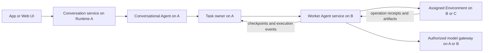

# Composable runtimes and distributed task dispatch

Updated: 2026-10-10. Design proposal for review; no implementation or model-visible tool changes are included. This page defines the proposed composition and federation architecture. [Current architecture](architecture.md), [Runtime contract](../crates/runtime/README.md), and [Agent/Sandbox design](agent-sandbox-design.md) continue to describe delivered behavior.

## Direction and agreed decisions

Each machine can host a Runtime. A Runtime hosts explicitly enabled capabilities and connects to other Runtimes. UI, conversational Agents, task execution, Host execution, and Sandbox execution are optional. Pot App supplies a convenient default composition of these capabilities; the same components can be deployed independently.

Agent, Task, and Environment have separate identities, lifecycles, and service contracts. They are composed through explicit assignments. Decoupling does not require separate processes or separate databases on one machine: local composition can use in-process adapters, while remote composition uses authenticated service adapters with the same semantics.

The user confirmed two decisions:

- Default task placement is local to the **Agent making the dispatch decision**. Opening that Agent through a UI on another machine does not change this default.
- Runtime connections grant capabilities explicitly. Pairing or network reachability does not grant unrestricted control.

The user has also confirmed that owner disconnection stops new effects until reconciliation, and that current data must be preserved through versioned upgrades. The P0 internal contracts below are the implementation baseline; future UI and model-visible tool changes still require their phase-specific review. Other recommendations remain design choices for review. Endpoint names, wire schemas, and changes to model-visible tools require a separate implementation review. In particular, this proposal does not approve changes to existing tool names, arguments, or behavior.

## Runtime and optional composition

Runtime is the capability host: instance identity, component registration, local service routing, connection lifecycle, authorization enforcement, and service health. Installed modules, enabled services, and active executions are distinct states.

A bare Runtime initializes its identity, configuration, and management access, then remains idle. It does not create a main conversation or default Sandbox, start an Agent/model request, dispatch a Task, run schedules, download images, or expose Host execution. A remote listener requires explicit configuration. Management and connection bookkeeping are the only baseline activity.

| Optional component | Responsibility | Required dependencies when used |
|---|---|---|
| UI / client | Connect, inspect, submit user intent, review approvals and results | Authorized access to the selected services; no local Agent required |
| Conversation service | Persistent conversations, input receipts, steering, chat notifications | Storage; an Agent assignment when executing a turn |
| Agent service | Run pot-agent turns, compaction and tool decisions | Thread/context services, a model gateway, and explicitly injected tools |
| Task service | Persist goals, guidance, state, assignments, dispatch and result receipts | Storage; a runner assignment when executing work |
| Host execution service | Scoped file, shell and supported computer operations on the Runtime machine | Explicit owner policy and OS execution support |
| Sandbox service | Environment inventory, lifecycle, leases, execution and optional desktop | Enabled Manager and qualified Providers |
| Model gateway / accounting | Model transport, credentials, budgets and usage receipts | Configured connection and permission to use it |
| Scheduler / notifications | Create task occurrences and deliver selected notices | Task service for scheduling; configured delivery for notifications |
| Artifact service | Inspect and explicitly transfer scoped artifacts | Authorized source/destination storage or Environment services |

Optional means an unused capability is unnecessary; it does not mean an enabled component can omit its required dependencies. Dependencies can be satisfied locally or through explicit remote assignments. Missing dependencies return capability/configuration errors rather than implicitly enabling another module.

Recommended deployment compositions:

| Composition | Enabled capabilities |
|---|---|
| Bare Runtime | Runtime management only |
| Environment node | Runtime plus Host and/or Sandbox services |
| Agent compute node | Runtime plus Agent service; local or authorized remote model/context services |
| Headless assistant | Runtime plus conversations, Agents, Tasks, model/accounting and selected execution services |
| UI entry point | UI plus connections to selected Runtimes; optionally an embedded local Runtime |
| Pot App | UI plus embedded Runtime and the usual assistant capabilities; Environment readiness remains independent |

An environment node can later accept Agent runs only if the Agent module is installed, explicitly enabled, and granted to the caller. A request to run an Agent cannot silently install code or enable services. Distribution/install automation is outside the first federation slice.

## Agent, Task, Thread, and Environment

| Entity | Owns | Does not own |
|---|---|---|
| Agent definition | Reusable model/settings/instructions and permitted capabilities | Task lifecycle, Environment lifecycle, all conversations |
| Thread | One persistent execution context and resolved configuration | Shared Agent persona state across unrelated conversations/tasks |
| Agent run | One bounded turn over a Thread, with injected services and scoped tools | Authoritative Task status or unrestricted machine control |
| Conversation | User messages, guidance, Thread and Agent assignment | A mandatory Task for every chat message |
| Task | Goal, ordered inputs, authoritative state, execution assignment and results | A concrete Agent implementation or a concrete Sandbox Provider |
| Environment | Execution capabilities, workspace/display scopes, leases, sessions and operation receipts | Agent context, conversation identity or Task success |

Conversational Agents and worker Agents use the same pot-agent implementation. Their role and grants determine available tools. Multiple conversations can use different Agent definitions; one definition can serve multiple independent Threads. No single global `main` conversation is required by Runtime.

A Task calls a runner contract. The first runner is pot-agent; this is not a proposal to restore the removed external-engine framework. The contract separates orchestration from execution without requiring multiple Agent engines. A taskless conversation can run an Agent; an Environment can serve an authorized terminal/API client without any Agent; a queued Task can exist without an active Agent run.

Worker roles initially retain existing restrictions: no recursive delegation, Environment management, or assignment switching. Multiple conversational Agents each receive an explicit control scope; being conversational does not confer global main authority.

### Three independent locations

Every dispatched Task resolves three positions:

1. **Task owner Runtime**: authoritative Task record, transcript, Thread context, ordered guidance, dispatch generations and result projection.
2. **Agent Runtime**: machine executing the pot-agent loop and its local orchestration processes.
3. **Environment Runtime**: machine supplying the assigned Host or Sandbox execution service.

These may be the same Runtime or different Runtimes. The model gateway is an additional independent service assignment; Agent placement does not imply model inference placement.



The common remote pattern is `Task owner A -> Agent B -> Sandbox B`. The environment-only pattern is `Task owner A -> Agent A -> Environment B`. Both use the same assignment model; a remote Environment does not need an Agent module.

## Service contracts and identity

Proposed service responsibilities below are conceptual contracts, not final tool or HTTP names:

| Contract | Operations and invariants |
|---|---|
| Runtime directory | Inspect identity, protocol compatibility, enabled/granted capabilities, health and bounded capacity metadata |
| Conversation | Create/list scoped conversations, accept idempotent input, guide/cancel turns, replay events |
| Task | Create/query, guide/interrupt/cancel, persist assignments, issue runs, accept deduplicated events, finalize results |
| Agent runner | Validate configuration, accept a scoped turn, checkpoint context, emit ordered events, cancel and reconcile |
| Environment execution | Describe capabilities, acquire scoped execution ownership, execute/poll, inspect receipts, cancel and reconcile |
| Environment management | Define/prepare/start/stop/delete/recover with authority, leases and busy checks |
| Model/context/approval services | Grant-bound inference, revisioned durable context writes and concrete owner decisions |
| Artifacts | List/read and explicitly copy bounded artifacts between authorized scopes |

Runtime has a stable instance identity independent of address and boot identity. A machine can normally use one Runtime, but multiple instances with separate roots and grants must remain distinguishable. Display names and IP addresses are not identities.

Remote references include `runtime_id` and a local object ID. Runs include a Task/Thread owner, dispatch generation, turn ID and immutable assignment revision. Environment references include generation; session and operation IDs remain bound to their original Environment and generation. An address change does not create a new Runtime, while a recreated Environment cannot masquerade as the old execution state.

Local adapters call services in process; remote adapters serialize bounded requests/events. Both enforce the same scoped authority, idempotency, persistence and cancellation rules. Local execution is not a privileged bypass. Remote payloads do not serialize local paths, trait objects, or native sockets as if they were usable on another machine.

The first release uses direct configured peer connections and caller-visible capability discovery. No mandatory central coordinator or global replicated database is needed. Every Runtime can act as caller and provider when configured; each Task still has one owner. Network reachability, relay infrastructure, and trust are separate concerns. Transitive discovery/control through another Runtime is deferred.

## Assignment and dispatch

Task creation persists the goal and fully resolved execution assignment before any Agent or Environment starts. The assignment records Task owner, Agent definition/configuration snapshot, Agent Runtime, Environment reference or absence, workspace/artifact scope, model gateway, grants, preference revision and selection reason.

Recommended resolution order:

1. Explicit choices for this Task override lasting preferences.
2. The dispatching Agent interprets the current saved prompt preferences against the authorized capability catalog.
3. With no matching preference, choose the dispatching Agent's Runtime for both Agent and Environment placement, using an explicitly configured eligible local Environment default.
4. Validate dependencies, permissions, readiness/provisioning policy and capacity; persist the assignment, then dispatch.

“Local” means the Runtime of the Agent making the dispatch decision, not the UI machine or the eventual worker's placement. The default Task owner is also this Runtime when it offers Task service; otherwise an explicit accessible Task service is required. UI reconnection and a proxy hop cannot change saved placement.

Local placement does not mean unrestricted Host execution. The App composition can supply a default Sandbox; other deployments can explicitly select an authorized Host Environment. Without a suitable local default, report the missing Environment instead of silently moving work to Host or a remote peer. Conversation-only work can omit an Environment. Capacity queues an already assigned Task; it does not silently pick another machine.

Saved preferences remain revisioned plain text rather than a new classifier or rules DSL. Examples include “Run builds on the Linux runtime”, “Use the Mac development Sandbox for Xcode”, or “Keep private source execution local”. The Agent receives safe names, IDs, capabilities and availability for authorized candidates. Names are resolved and references validated before dispatch. Ambiguous/unavailable required choices require clarification or a visible wait/failure. A prompt cannot grant access or enable an absent capability.

Routing preferences default to the dispatching Agent definition, with explicit shared preference records possible in the App composition. Independent conversational Agents need not share one global rule document. Snapshot the revision/reason per Task; edits affect new assignments, not running Tasks. Workers receive applicable execution instructions but cannot rewrite routing policy.

First scope fixes the Environment assignment across Task follow-ups and fixes Agent Runtime for the Task. Configuration updates can still occur at safe turn boundaries. Reassignment/migration is separate future work; cancellation or disconnect never implies migration. Schedules resolve and save explicit Runtime/Environment references and use their recorded dispatch origin for local defaults, rather than whichever UI is open when they fire.

## Ownership, persistence, and failure

Task state is written only by its owner. The Agent Runtime keeps a durable execution journal and bounded context cache, not an independent competing Task record. Context checkpoints are revisioned and acknowledged by the Task owner before further model/tool work. Conversation-owned Threads use the same rule with their conversation owner. An Environment-only node stores operation/session receipts and artifacts without needing the Task database.

Recommended remote lifecycle:

1. Owner persists an assignment and generation, then sends an idempotent run request.
2. Agent Runtime durably accepts that identity before starting; a duplicate returns the existing receipt, while conflicting reuse fails.
3. Agent Runtime prepares the assigned Environment under the granted lifecycle policy, then emits generation/turn/sequence-bound events and context checkpoints.
4. Environment records operation intent/receipt before returning success; retries inspect the same operation rather than executing it again.
5. Task owner deduplicates events, commits checkpoints and records the final outcome only after operation cleanup is settled.

There is no global exactly-once claim for external effects. At-least-once message delivery is combined with durable deduplication and explicit unknown outcomes. Dispatch timeout does not prove that the peer rejected the run. The owner must inspect that run identity before issuing any replacement. No automatic reassignment occurs in the initial design.

| Failure | Required behavior |
|---|---|
| UI disconnects | Task and Agent continue under their existing policy; reconnect replays owner events |
| Task owner connection lost | Agent starts no new model requests/tools after loss is detected; current operations follow their bounded timeout/lease policy and journal outcomes for reconciliation |
| Environment connection lost | Mark the operation unsettled; do not replay or fall back to another Environment |
| Runtime restarts | Recover durable receipts; started but unconfirmed work becomes interrupted/unknown; reconcile before continuation |
| Cancel requested while peer is unreachable | Persist cancellation intent and display cleanup pending; finalize cancellation only after verified settlement |
| Stale generation/context revision | Reject updates and new effects; return authoritative reconciliation metadata |
| Shared Sandbox busy | Queue or return busy; task cancellation does not stop the shared Sandbox |

Run grants have bounded leases. Environment brokers enforce operation bounds and reject new effects under an expired/revoked grant; Agent cooperation alone is insufficient. Revocation prevents new work and requests scoped cleanup; reachability failure must not be reported as confirmed cleanup. Longer autonomous continuation through owner outages can be a later explicit policy, with separately designed budgets/context durability.

The Task owner issues one active execution generation and does not authorize a replacement until old effects are settled. “Stopped” does not mean prior network/UI effects were rolled back. Losing the sole owner can prevent new dispatch/continuation; automatic owner failover and distributed consensus are outside the first scope.

Artifacts initially remain on their Environment Runtime, referenced by stable scoped metadata and accessed through authorized services. A result is not automatically copied into the UI machine's filesystem. Explicit transfer validates source/destination scope, relative path, size and digest, persists a receipt and reports interrupted transfers. Local machine paths and guest credentials never become client-side access tokens.

## Trust and approvals

Peer enrollment binds stable identities using authenticated encrypted transport, such as pinned certificates/mutual TLS. Each direction has its own revocable grant. Existing browser instance Tokens remain browser credentials and are not reused as unrestricted peer identities.

Grant dimensions include target service/action, Environment/object scope, principal/role, expiry and resource/budget bounds. Separate grants cover Agent runs, Task submission/inspection, Environment execution, Environment management, artifact access, model gateway use, and owner administration. An Agent-run grant does not implicitly permit Host execution or starting/deleting a Sandbox.

Effective authority is the intersection of caller permission, delegated run scope, target Runtime policy and Environment capability. A provider Runtime validates the original principal and narrowed scope, not just a trusted intermediary. No transitive control is inferred from A trusting B and B trusting C. A three-Runtime assignment requires explicit usable grants for each service edge.

Approvals return through the owning conversation/Task service and any authorized UI, while the target Runtime enforces its own policy. With no approval channel, a request needing approval waits or fails visibly. A previous approval remains bound to its concrete target, arguments and generation. Preference text and remote prompts never bypass this boundary.

Remote Agent execution necessarily discloses the supplied context to that machine; remote model gateways disclose model input to their configured providers. Show these locations when inspecting an assignment. Credentials stay with their owning gateway/Environment service; workers receive scoped handles, not provider keys, root peer tokens or management credentials. A remote Agent uses either an explicitly granted owner gateway or an explicitly selected peer gateway, with budget authorization before inference and usage receipts attributed to the Task without double counting.

## UI and product composition

App can retain its embedded local Runtime and add connections to remote Runtimes. A standalone UI can operate without a local assistant. Each view identifies its selected service/owner and offers only granted capabilities.

Multiple conversational Agents appear as separate conversations/assistants with their own Threads, defaults and prompts. Tasks show owner, executing Agent/Runtime, Environment/Runtime and artifact location. Environment views aggregate authorized remote inventories without implying that every node provides conversations or Tasks.

Missing capabilities are presented as deployment properties: an Environment-only node remains usable without AI configuration; an Agent-only node has no implied terminal; a bare Runtime is idle rather than a broken chat. Unreachable state, queued capacity, approval needed, interrupted work and cleanup pending remain distinguishable.

App's default assistant is a composition preset. Closing a remote UI does not shut down its Runtime. Explicitly quitting an embedded Runtime affects that instance's owned execution and remote run grants according to cleanup policy; it does not authorize shutting down peer Runtimes or shared peer Sandboxes.

## Concrete implementation design

This section describes proposed internal interfaces and refactoring boundaries. These names are design vocabulary, not approved model-visible tools or final public APIs.

### Composition root and dependency direction

Keep `pot-server` as the process/listener and assembly entry point. Make `pot-runtime` the capability host and shared coordination infrastructure. Initially implement the separated services as Rust modules with private state; extract crates where dependency boundaries require it. Runtime must not construct a mandatory assistant merely to serve an Environment.

```text
                 pot-app / Web UI / CLI
                           |
                       Client API
                           |
             pot-server: assembly + transport
                           |
       pot-runtime: identity + registry + policy
                           |
       +-------------------+-------------------+
       |                   |                   |
 Conversations         Task service        Agent service
       |                   |                   |
       +---- Thread store -+---- RunnerPort ----+
                                               |
                                           pot-agent
                                               |
                 +-----------------------------+--------+
                 |                             |        |
             ContextPort                   ModelPort  ToolExecutor
                                                         |
                                                   EnvironmentPort
                                                         |
                                         +---------------+-----------+
                                         |                           |
                                    Host executor              pot-sandbox
                                                                     |
                                                                 Providers
```

These are caller dependencies, not a requirement that all modules share one deployment. Conversation and Task services depend on a runner interface; they must not depend on Agent internals. Agent service implements that interface using pot-agent and injected services. Environment service neither imports Task service nor queries Agent context. Storage modules persist their owning service's data; the registry does not become a second global product database.

Use a typed service bundle with independently registered capabilities and explicit dependency references. Avoid converting every field in the existing `Service` into an `Option` while retaining its product assumptions. A missing optional service is handled at composition/assignment validation. Keep HTTP/DTO handling in transport adapters and domain commands outside Axum handlers so local and remote callers use the same validation.

Server startup reads an explicit composition, registers enabled services, validates dependencies, opens only their stores, mounts their routes, and starts only their coordinators. Bare composition registers management only. App passes its assistant preset. Runtime enablement is independent of optional build-time packaging; an installed module need not be enabled. Providers are registered only when the selected Environment composition requires them.

### Persisted records and internal ports

Recommended records:

```text
RuntimeRef     = stable instance ID
ObjectRef      = RuntimeRef + object ID
AgentDefinition= settings/model template + prompt/preference reference
Thread         = owner reference + config snapshot + context revision
Task           = goal + inputs + phase + Assignment + active RunRef
Assignment     = Agent Runtime/config + EnvironmentRef? + gateway + scopes
RunRef         = owner + dispatch generation + turn ID
OperationRef   = RunRef + tool call ID + Environment generation
```

Keep the existing Thread configuration and context concepts. Task assignment adds Runtime references around them, rather than rebuilding removed engine bindings. Distinguish dispatch generation, Thread configuration generation, and Environment generation: they fence different kinds of stale work. Any mapping among them is recorded in the accepted run receipt.

Recommended port boundaries:

- `RunnerPort`: accept/query/cancel a bounded run and replay its durable event sequence.
- `EnvironmentPort`: describe/lease/execute/poll/cancel/reconcile scoped operations. Management has a separate authorization surface.
- `ContextPort`: load and compare-and-swap a checkpoint for one owner/Thread revision.
- `ModelPort`: infer under a granted gateway/budget and return attributable usage receipts.
- `ControlPort`: consume ordered guidance, acknowledge it after checkpointing, and request concrete approvals.

Preserve and evolve the existing `ToolExecutor` and `ExecutionServices` as appropriate. `ExecutionFeedback` and the Agent event sink currently include synchronous storage acknowledgements. Remote checkpoints and durable event emission need asynchronous acknowledgements in the Agent loop, with a synchronous local database implementation wrapped behind the async port. Do not perform network waits while holding a SQLite transaction or state mutex. A background queue without awaited durable acknowledgement is insufficient for contexts and terminal receipts; transient display deltas can be batched separately.

Task creation commits the Task, assignment, and pending-dispatch entry atomically in the Task owner's store. A dispatcher drains that durable entry using a stable RunRef. The accepting Agent service persists the matching inbox receipt before returning acceptance. Ordered events use a durable outbox on the Agent Runtime; acknowledgements allow bounded compaction while final receipts remain queryable. This closes the crash window between saving a Task and sending its run, without promising exactly-once external effects.

### Local and remote adapters

```text
Task dispatcher              Agent tool routing
      |                              |
  RunnerPort                   EnvironmentPort
      |                              |
  resolve RuntimeRef           resolve RuntimeRef
      |                              |
  +---+----------+              +-----+---------+
  |              |              |               |
local          remote         local           remote
  |              |              |               |
direct        peer RPC       direct          peer RPC
  |              |              |               |
  +-- Agent service             +-- Environment service
      authorizes                    authorizes
      journals                      journals
      executes                      executes
```

Remote adapters use authenticated versioned requests and bounded replayable event streams, initially HTTP plus SSE with cursors. A dropped stream reconnects to the durable journal; it does not create another run. Direct adapters still call the destination service's authority checks. Peer transport carries the principal, narrowed grant, object/run scope, request identity and deadline. Destination authorization remains mandatory.

The UI has a separate client transport abstraction: embedded local dispatch or an authenticated remote client. UI credentials remain separate from peer execution grants. Cache and cursor keys include Runtime/owner identity; switching connections must not merge messages, permissions, or event sequences from different nodes. Each page first reads the granted capability projection and requests only supported services.

### Mapping current code to the target

| Current seam | Proposed change |
|---|---|
| `runtime/src/lib.rs`: monolithic `Service` | Separate Runtime host, Conversation service, Task service, Agent service and Environment service state |
| `runtime/src/bootstrap.rs`: mandatory main loop and Task coordinator | Composition builder plus enabled-service startup/shutdown; App supplies its preset |
| `runtime/src/tasks.rs`: worker copies full `Service` and creates local workspace | Persist assignment and dispatch through RunnerPort; acquire workspace on the Environment Runtime |
| `runtime/src/agent/runner.rs` and `runner/feedback.rs` | Agent service constructs scoped ports; async checkpoint/event acknowledgements; no mandatory Sandbox lease for an Environment-free turn |
| `runtime/src/sandbox.rs`: Agent resources stored beside Manager wrapper | Move instructions/skills/home concerns to Agent resource services; inject Environment ports; preserve Manager lifecycle/receipts |
| `core/src/execution.rs` | Transport-neutral IDs/assignments and narrow async contracts; no network client implementation |
| `protocol` | Versioned wire DTOs and capability projections, independent from native paths and trait objects |
| `server/src/hosting.rs` and `routes.rs` | Register selected Providers/services/routes; separate browser, operator and peer authentication |
| `app/src/backend.rs`, `client.rs`, shared UI state | Connection-aware transport, explicit conversation/Task owner references, capability-driven pages |

Do not change the meaning of existing model-visible `host`/`sandbox` targets behind their current schemas. Internal routing can use an already resolved assignment; exposing remote selection or broader main authority requires the separately agreed tool proposal. Model-visible changes also include prompt/default behavior, not just schema additions.

For local rollout, the App preset retains existing behavior while new services gain explicit owners and references. Protocol changes must be versioned and deployed with clients. Decide storage conversion versus a fresh-root requirement before that implementation slice; this proposal does not silently discard existing data or invent a legacy migration path.

## P0 implementation baseline

This section turns the proposal into implementable contracts. P0 is complete as of 2026-10-10: the user confirmed stopping new effects on owner disconnection and preserving current data through versioned upgrades. The internal contracts below guide P1; future model-visible changes remain explicitly pending at their respective phases. UI confirmation occurs when its phase is reached.

### Ownership and records

Use versioned serialized records for cross-service values. IDs are opaque stable strings; the first implementation generates UUIDs. Local object IDs are always interpreted with their Runtime identity and authorized owner scope, never by display name or a local filesystem path. Accept only bounded IDs at the transport boundary and validate path segments independently before constructing filesystem paths.

```text
RuntimeIdentity
  schema_version, runtime_id, public_identity, created_at_ms
  boot_id is transient and is not the stable instance identity

ObjectRef
  runtime_id, object_id

ThreadRecord
  owner_ref, thread_id, config_generation, config_snapshot
  context_revision, context

Assignment
  schema_version, revision, task_owner_ref, dispatch_origin_runtime
  agent_definition_ref, agent_runtime_id, resolved_config_snapshot
  environment_ref?, environment_generation?, workspace_scope?
  gateway_ref, artifact_scope?, granted_service_refs
  preference_revision?, selection_reason

RunRef
  owner_ref, thread_id, dispatch_generation, turn_id

RunReceipt
  run_ref, assignment_revision, config_generation, request_digest
  phase, accepted_at_ms, lease_deadline_ms, last_durable_sequence

OperationRef
  run_ref, tool_call_id, environment_ref, environment_generation

Checkpoint
  run_ref, expected_context_revision, checkpoint_id, context

DurableEvent
  run_ref, sequence, event_id, kind, bounded_payload
```

Assignment snapshots never contain raw provider credentials or reusable administrator tokens. Grants are destination-validated capabilities with explicit scopes/deadlines. Environment generation is fixed when readiness/ownership is acquired, before the first tool effect; a queued assignment can name a stopped Environment without pretending its next boot generation is already known. Persist the resolved generation in the run's acquired scope receipt and reject later mismatches.

Task/Conversation owners retain their own Thread records and transcripts. Agent service only owns run journals and permitted local caches. Environment service only owns environment definitions, scope/session/operation receipts and artifacts. Model gateway owns provider credentials and request/usage ledgers. Runtime host owns identity, composition and configured connection metadata, without opening product stores for disabled services.

### Internal command contracts

All effectful commands include an authenticated principal, narrowed grant, request identity and deadline. A request identity is scoped to its owner/object, not globally reusable across arbitrary resources. Identical replay returns its original receipt; a conflicting digest returns a conflict. Validation/authorization precedes recording acceptance or starting effects.

| Port | Proposed internal commands | Durable acknowledgement |
|---|---|---|
| Runner | accept(run, assignment, input), inspect(run), events(run, after), interrupt(run), cancel(run) | Acceptance is journaled before start; final state remains inspectable |
| Context | load(owner, thread), commit(checkpoint) | Compare-and-swap plus checkpoint receipt commit atomically; identical checkpoint replay does not increment revision again |
| Control | pending_input(run, after), acknowledge_input(run, IDs, checkpoint), request_approval(concrete_operation) | Input order and acknowledgement survive restart; acknowledgement requires its committed context checkpoint |
| Model | infer(run, request, gateway), inspect_request(request) | Reserve budget before upstream networking; receipt distinguishes unknown outcome from an unstarted request |
| Environment execution | acquire(assignment, run), execute(operation, args), poll(operation/session), inspect(operation), cancel_scope(run), release_scope(run) | Record operation acceptance and terminal outcome; duplicate execute cannot replay side effects |
| Environment management | list(scope), define/start/stop/delete/recover(object, request) | Persist lifecycle intent/outcome; respect active leases and unsettled outcomes |
| Artifact | list/read(scope), copy(source, destination, request) | Copy metadata/receipt records destination, digest and completion; never treat partial bytes as complete |

Expose typed service handles in-process and versioned wire DTOs remotely. Ports never accept the complete Runtime Service or a database connection from their caller. Reads return scope-limited metadata and bounded pages. Pure model/conversation turns do not need an Environment lease. Acquire the task Environment scope only for work that requires it; retain applicable per-turn/per-session leases and existing Provider containment.

### Task state and run state

Keep Task state, run state and cleanup state separate rather than encoding every combination as a new TaskPhase. Existing client TaskPhase projections can be preserved until the relevant protocol/UI phase is confirmed.

```text
Task goal state:
  queued -> waiting -> running -> complete
     |         |          +----> failed / interrupted
     +---------+----------+----> cancellation_requested
                                      |
                           verified cleanup -> cancelled

Run dispatch state:
  pending -> accepted -> running -> settling -> terminal
      |         |           |          |
      +---------+-----------+----------+-> reconciliation_required

Cleanup state:
  none -> requested -> pending -> confirmed
                         |
                    unknown outcome
```

`waiting` records a reason such as capacity, dependency, approval or disconnected target. Task completion requires an accepted final run outcome and confirmed relevant cleanup. Do not derive completion from a closed SSE stream. A normal turn may retain existing authorized managed sessions; terminal turn receipt distinguishes permitted retention from unsettled operations. Explicit Task cancellation or failed-run cleanup drains the run/session scope according to the existing contract, never another user's shared Environment.

Interrupt preserves queued guidance and requests a safe execution boundary. Cancel abandons this Task execution and follows the existing guidance-discard/archive semantics only after its durable cancellation intent is committed. A subsequent authorized follow-up uses a new run identity with the same Task/Thread; it does not reissue a previous uncertain operation.

Unknown acceptance/outcome blocks a replacement dispatch. The owner can query the original RunRef and reconcile. A new generation is issued only after the previous run's ability to perform effects has been revoked/fenced and operations are settled. Expired leases prevent new effects; they are not proof that previous external effects were rolled back.

### Transaction and restart ordering

1. Owner validates and atomically writes Task/input, Assignment, RunRef and dispatch-outbox entry.
2. Dispatcher sends the outbox entry; receiver atomically writes the matching acceptance/digest before starting. A lost response is resolved with inspect/replay for the same identity.
3. Agent Runtime durably journals ordered execution events and checkpoints. Context owner commits checkpoint/context-revision and deduplication receipt in one transaction before acknowledging it.
4. Environment broker records accepted operations before executing. Output polling reads the existing operation/session receipt; it does not redispatch a command.
5. Agent journals its terminal outcome only after cleanup is settled or explicitly unconfirmed. Task owner commits final projection plus replay cursor before acknowledging terminal delivery.

Restart reads durable records first. Previously started runs cannot resume automatically merely because a worker queue is present. Restore pending-but-unaccepted entries using the same RunRef, inspect accepted/uncertain runs, preserve interrupted context and reconcile operations. Stable identity and boot identity are distinct; stale boot-scoped session handles must fail. For a corrupt/future schema, reject startup visibly rather than overwriting records or constructing empty context.

Keep transactions local to one store. Cross-Runtime atomicity uses idempotent messages and receipts rather than holding database transactions while performing network requests. SSE cursors are scoped per owner/run; transient text deltas can be coalesced, while acceptance/checkpoint/input/final receipts must survive restart. Slow consumers receive bounded pages/backpressure instead of an unbounded event buffer.

### Rollout and review inventory

P1 preserves the App assistant preset's existing tools and environment defaults. New bare/Environment-only presets are explicitly configured deployments and expose no accidental assistant loadout. Legacy retired Agent-engine/native-session import is excluded. Current product roots must be preserved through versioned upgrades. Add identity/composition metadata without moving current files in P1; retain existing SQLite messages, Thread/config/context keys, Task IDs and Sandbox/workspace paths. When later phases require conversion, lock the instance, validate the existing schema, create a private consistent backup before destructive layout changes, commit each store conversion atomically, and journal cross-store progress. Repeating an interrupted upgrade must not duplicate objects or dispatch work. Unknown/corrupt/future versions fail visibly. Retired-engine imports remain excluded.

Concrete future model-visible proposals to review at their phase, not implementation authorization:

| Phase | Candidate change | Agreement status |
|---|---|---|
| P1 | None: existing App tool names/arguments/behavior are retained | No tool-interface change proposed |
| P2 | Existing task/preference/management tools become scoped to the selected conversational owner instead of a global main owner; worker authority stays fixed | Pending concrete scoped behavior and UI review |
| P3 | Add an explicit remote Environment reference to task placement/Environment selection; expose granted Runtime/Environment metadata; preserve existing local arguments | Pending concrete tool/schema review |
| P4 | Add an explicit Agent Runtime to task placement and run inspection; distinguish its location from Environment location | Pending concrete tool/schema review |
| P5 | Extend preference candidate metadata to Runtime placement and add scoped cross-node artifact actions | Pending concrete tool/schema review |

Initial cross-Runtime wire service version is independently negotiated from the existing frontend snapshot version. Local clients retain existing snapshots during P1; changes to conversation identities/capability-driven pages are introduced with supported clients in P2/P3. Peer compatibility failures are visible before acceptance; newer unknown effectful command variants are never guessed or downgraded.

P1 needs no new App UI interaction if it keeps the current preset and exposes deployment composition through operator configuration. Any discovered change to switches, empty states, onboarding or prompts must be added to Issue #39's pre-phase checks before implementation. P2–P5 require concrete interaction review at execution time; their current roadmap descriptions are not UI approval.

## Implementation sequence and acceptance

The [phase roadmap](development-plan.md#composable-runtime-roadmap--proposed-2026-10-10) expands this sequence into P0–P6 deliverables and exit gates, including design review and deployment qualification. That roadmap is proposed rather than an implementation status claim.

Current code already provides injected `ToolExecutor`, `ExecutionServices`, `ExecutionFeedback`, concrete pot-agent execution and a separate Sandbox Manager/Provider boundary. However, Runtime `Service` holds a mandatory Agent executor, Task hub, Sandbox manager and hard-coded main conversation. Bootstrap starts the main loop and Task coordinator; Server registers platform Providers automatically. These are the composition seams to change, rather than reasons to introduce another Agent engine.

Recommended sequence:

1. **Local optional composition**: define service registration/dependency validation, extract conversation/Task responsibilities from the monolithic Service, make modules and defaults explicit, and retain the App preset. Keep existing single-runtime behavior through local adapters.
2. **Multiple conversations**: replace global-main assumptions with scoped owners/Threads and explicit Agent assignments; preserve turn serialization, steering, permission ownership and per-Thread budgets.
3. **Remote Environment**: peer enrollment/directory and grants, stable references, execution/management adapters, durable receipts, cancellation and scoped artifact reads. Demonstrate Agent A executing against Environment B with B having no Agent service.
4. **Remote Agent with co-located Environment**: owner A dispatches to Agent B + Sandbox B; qualify context checkpoints, model gateway assignment, budgets, deduplication and lost-owner cleanup.
5. **General composition**: Agent B uses Environment C under direct explicit grants; qualify artifact transfer, saved routing prompts and schedule placement.

Internal service/wire design precedes any model-visible tool proposal. Existing tools retain their current contracts until the user explicitly agrees to concrete changes. New tool names/arguments are intentionally not specified here. Proposed crate extraction should follow actual ownership boundaries after local interfaces stabilize; no new public Driver/Engine/session-mapping layer is required.

Acceptance must cover:

- Bare Runtime performs no model calls, task dispatch, scheduled work, image download or Environment startup; absent capabilities are reported accurately.
- An Environment-only Runtime supports authorized execution and refuses Agent runs; merely connecting never enables Host execution or Environment management.
- UI A controls a conversation on B; default dispatched work stays on B. An explicit remote preference resolves and persists the intended assignment.
- Two conversational Agents maintain independent Threads/preferences/authority and can create independent Tasks without a global-main dependency.
- Agent A + Environment B and Task owner A + Agent B + Sandbox B work end-to-end; a subsequent Agent B + Environment C run needs explicit grants.
- Duplicate dispatch, events, checkpoints and commands do not duplicate effects; conflicts and stale generations fail. Unknown external outcomes remain visible and are not replayed.
- Disconnect/restart/cancellation settle or quarantine scoped operations, preserve context/artifacts and leave unrelated Tasks/shared Environments available.
- Revoked/expired grants and attempts to enlarge scope fail at the destination, including while a caller is disconnected. Credentials do not enter ordinary tool output or guest mounts.
- Task owner and gateway usage do not double count inference; unavailable peers/defaults do not cause silent Host fallback or migration.

The first federation milestone ends with direct peers and a single authoritative owner per Task. Dynamic module installation, recursive worker delegation, live Task/owner migration, automatic peer failover, consensus scheduling and transitive peer relays remain outside that milestone.
