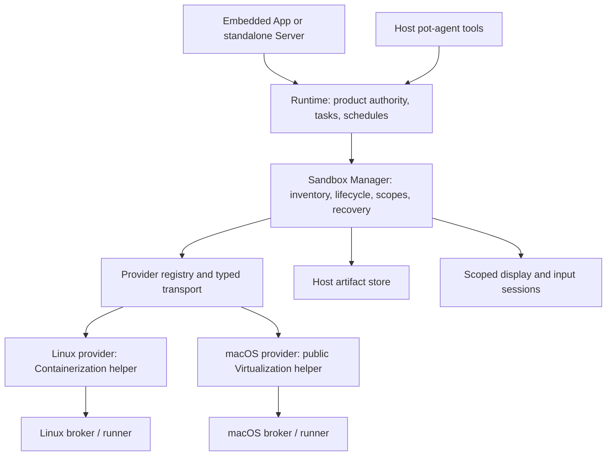

# Sandbox provider redesign

Updated: 2026-10-07. Target design for the first-phase Linux and macOS environments. **Linux runs through Apple Containerization on macOS and rootless Podman on Linux; prepared-instance macOS VM qualification remains pending.** See [Linux Server acceptance](validation/linux-server-clients-20261007.md) for the Linux host verification and limits; [architecture](architecture.md) describes delivered behavior. This page defines provider contracts; [Agent/Sandbox design](agent-sandbox-design.md) defines authority and task placement. Android, iOS and Windows remain future extensions, not prerequisites.

## Delivered extraction and remaining design

`pot-sandbox` owns inventory, selection, lifecycle/readiness, leases, owner/turn/epoch scopes, session binding, private JSON receipts and unknown-outcome recovery. `pot-sandbox-macos-apple-container` owns helper IPC and authenticated guest HTTP. `pot-sandbox-macos-apple-vm` implements owner-enrolled VZ instances, pinned TLS transport and exclusive session closure in a persistent VM; see [enrollment and limits](macos-sandbox.md). Server explicitly registers it; production Runtime has no concrete Provider dependency. Legacy definitions default to the Linux Provider; old product receipts are imported once without replaying unknown operations. Durable Manager epochs advance on reopen or observed Helper generation change.

Storage currently uses atomic private JSON under `product/`, not the proposed injected SQLite store. Source `TemplateDescriptor` parsing and Linux build metadata are delivered; installed template catalogs, allocation reservations, artifact transfer, event subscriptions and general display/automation adapters below remain design targets. Ticket-scoped RFB display arbitration is delivered as described at the end of this page. Provider calls currently use a bounded lifecycle protocol plus the existing validated guest JSON protocol. This page distinguishes that delivered slice from the broader target.

## Scope and architectural decision

A Sandbox is a managed execution environment with identity, persistent state, lifecycle and qualified capabilities. A shell, a POSIX workspace, a routable IP and a browser desktop are optional capabilities rather than the definition of a Sandbox.

| Required environment | Initial provider | Execution model |
|---|---|---|
| Linux on Linux | `linux.podman` | Rootless container, private broker, command/file tools and optional desktop |
| Linux on macOS | `macos.apple-containerization` | Existing guest broker and command/file tools; optional desktop |
| macOS | `macos.apple-virtualization` | Native VM, protected guest broker, command/file tools and macOS display |

The Apple engines target an Apple silicon Mac host; Podman targets Linux. Linux handles default and isolated work; macOS handles native application development. Supporting a standalone Linux backend does not imply a Linux-host VM provider. Android and iOS are deferred: [Android research](research/android-provider.md) and [vphone research](research/vphone-provider.md) remain background, not first-phase dependencies.



Runtime owns product policy, task orchestration and product records. A dedicated Sandbox Manager owns environment policy enforcement, durable environment state and execution coordination. Providers own engine-specific mechanics and OS transport. The main Agent may express managed lifecycle intent; task workers operate only their assigned environment. Model-selected host subprocess execution remains absent. Host helpers launched by trusted Runtime infrastructure are not Agent Host tools.

## Dedicated Sandbox management layer

Use `Manager` in a Rust `pot-sandbox` crate between Runtime and Providers. It is a domain service, not merely a Provider registry or a collection of forwarding functions. Runtime calls one typed service; it does not inspect provider handles, boot addresses, ADB transports or VM engine types. Providers cannot call back into task/chat orchestration.

```text
Runtime calls Manager -> registered Provider trait objects -> helpers / guests
                              |
                              +-> environment store, artifact store, event stream

Cargo dependencies: Runtime -> pot-sandbox <- concrete Provider crates
```

The initial service is in-process, constructed by the embedded App or standalone Server composition root and injected into Runtime. It needs no new daemon/socket, and must not depend on `pot-runtime`. Shared domain DTOs live in `pot-sandbox`; product/API DTOs in `protocol` map to them at the boundary. Transport extraction can follow later without changing domain semantics.

| Layer | Owns | Does not own |
|---|---|---|
| Runtime | Conversations, Thread contexts, tasks/schedules, immutable task-to-sandbox binding, product permissions and tool schemas | Provider routing, VM health, ADB commands, scope cleanup or environment receipt ledger |
| Sandbox Manager | Provider registration/probe, profiles/templates, environment inventory/allocation, lifecycle/readiness, capacity/locks/leases, execution scopes, capability enforcement, receipts/recovery, artifacts and display/input arbitration | Models/prompts, task dependency graphs, schedule triggers or chat presentation |
| Provider | Engine-specific preparation/start/stop/inspect, authenticated guest transport, qualified shell/device/files/display operations and cleanup primitives | Product authorization, choosing a task target, global allocation or shared recovery policy |

Runtime authenticates the caller and decides whether a main/worker/owner may request an operation. It supplies a trusted `AccessGrant` with opaque subject/owner IDs, fixed target/allocation permission, allowed capabilities/resources, expiry and cancellation policy. The Manager validates this grant and checks environment policy, readiness, epoch, scope and leases on every operation. Worker requests cannot manufacture grants. Private service APIs and Manager-issued opaque scope handles carry authority initially; any future remote service must authenticate the Runtime channel and grant provenance rather than trusting caller-supplied fields.

Runtime persists task/schedule bindings. The Manager persists definitions, instances/epochs, reservations/scopes/leases, environment operation receipts, artifact metadata and preparation state. These have one authoritative writer each. Its store is behind an injected storage interface, with namespaced SQLite tables and Host artifact storage initially; it does not read task tables. Provider credentials/handles remain private to the Manager/adapter. Product history may reference a receipt ID but must not create a second authoritative receipt state machine. Manager events project status into Runtime/UI; they cannot grant permissions or declare a task successful on their own.

Allocation is a recoverable handshake, not a distributed transaction hidden in a tool call: Runtime supplies a stable request ID; Manager reserves an environment and returns its ID/reservation; Runtime persists the immutable binding; it then confirms the reservation before scope creation. Repeated requests recover the same allocation. Execution requires confirmation, and unconfirmed reservations expire without deleting published artifacts or product records. Startup reconciliation finishes committed bindings or releases uncommitted reservations; active/unknown operations never expire into blind reuse. No Provider call runs inside a product database transaction.

Minimum facade (method names illustrative):

```text
list / describe / capabilities
allocate(request_id, profile, allocation_policy, grant) -> reservation
confirm_allocation(reservation, binding_ref, grant)
prepare / start / stop / destroy -> operation_id
open_scope(binding_ref, sandbox_id, grant) -> scope_handle
execute(scope_handle, call_id, typed_action) -> receipt
cancel_scope / close_scope -> cleanup_result
publish_artifact / transfer_artifact
open_display / acquire_control / release_control
inspect_operation / subscribe_events
```

Management methods require lifecycle authority; execution methods accept only their issued scope handle. Shell, file, device and display actions remain typed capabilities; avoid a universal unvalidated JSON command. Long-running lifecycle calls return durable IDs/progress, and execution cancellation returns confirmed cleanup or uncertainty. Events include sequence, sandbox ID, epoch and operation ID; reconnect obtains a state snapshot and resumes events. Provider-specific details are bounded diagnostic data, never generic execution authority.

Keep task scheduling and environment scheduling distinct: Runtime chooses which task to run and its requested profile/target; Manager allocates the authorized resource, reserves Host capacity and queues its execution lease. Runtime renders these waits as task status. Manager never swaps a bound environment merely because another one is ready.

## Provider crates and explicit registration

Each concrete Provider is a separate workspace crate implementing the public contracts in `pot-sandbox`. The Manager invokes registered implementations through trait objects; `pot-sandbox` has no Cargo dependency on any concrete Provider. Runtime sees only the Manager facade. Runtime call direction and Cargo dependency direction are deliberately different.

| Crate / directory | Responsibility | Dependencies |
|---|---|---|
| `pot-sandbox` / `sandbox/` | Manager, registry, provider/capability traits, domain types, store interface, policy enforcement and recovery | General infrastructure; no concrete Providers or Runtime |
| `pot-sandbox-macos-apple-container` / `sandbox-providers/macos-apple-container/` | Existing Apple Containerization helper/client and Linux guest adapters | `pot-sandbox`; platform/helper dependencies |
| `pot-sandbox-macos-apple-vm` / `sandbox-providers/macos-apple-vm/` | Public Virtualization.framework helper/client and native guest adapters | `pot-sandbox`; platform/helper dependencies |
| Existing App/Server composition root | Construct enabled Providers, register them, inject Manager into Runtime | `pot-sandbox`, selected Provider crates and Runtime |

Crate names group the initial OS integrations; the stable registry ID identifies the actual engine (`macos.apple-containerization`, `macos.apple-virtualization`). A future Linux engine can use its own crate and ID without changing existing definitions. Do not turn OS names into routing switches in Runtime or Manager.

Registration is explicit at backend construction, conceptually:

```text
builder = SandboxManagerBuilder(store, artifact_store, environment_policy)
builder.register(linux_provider)
builder.register(macos_provider)
manager = builder.build()
runtime = Runtime(product_services, manager)
```

The shared App/Server assembly path performs this once per backend; it may use build features and target-specific dependencies to select integrations. Registration rejects duplicate engine IDs and incompatible contract versions. It installs trusted metadata/qualification and does not itself download images, accept licenses or launch guests. Probe distinguishes compiled/registered, installed, host-compatible, prepared and execution-ready state. Missing optional Providers leave saved definitions visibly unavailable and retain their state; they do not prevent chat or other Providers from starting. No runtime `dlopen`/Rust ABI plugin scheme is required.

Keep the Provider interface small and platform-neutral. A required object-safe async lifecycle contract covers descriptor/probe, prepare/start/inspect/stop/destroy and outcome reconciliation/cleanup. Optional typed adapter contracts cover shell, files, device, display and snapshot operations. An instance exposes only its supported adapters; absent capability returns a typed unavailable error rather than a no-op. Shared execution context carries operation ID, epoch, deadline/cancellation and bounded resource grants. Guest endpoints, process handles and transport credentials remain internal. Concrete errors map to common codes plus bounded diagnostic details.

Provider code translates requests and performs engine/guest operations; Manager remains the single authority for grants, locks/capacity, epoch changes, leases, durable receipt transitions, retry policy and artifact publication. Providers must cooperate with scoped cleanup and report ambiguous dispatch honestly. Shared instance handles support Manager-authorized concurrency; adapter presence or Rust `Send + Sync` is not evidence of independent execution containment. Providers receive narrowed operation context, not access to the Manager store, task tables or grant-creation API.

Each crate owns provider-specific configuration validation and schema version migration. Persist a tagged/versioned config envelope; generic policy, resources and capabilities remain typed domain fields. Accept config only through that registered schema, never as arbitrary executable arguments. Packaging pins/signs the required external helper or SDK and audits its licenses separately from the Rust crate; separate crates do not turn Swift VZ engines into Rust code.

Use Manager contract checks with a fake Provider and run the same relevant conformance cases against concrete Providers: lifecycle state/readiness, unsupported capability, scope/epoch mismatch, cancellation settlement, crash/unknown recovery and credentials. OS-specific acceptance supplements those checks. Shared guest protocol/client code may be extracted later when real duplication appears; keep platform dependencies out of `pot-sandbox` now.

## Image/template descriptions and storage

Keep image definitions separate from Provider Rust implementation. Put maintained source recipes under a top-level `sandbox-images/` tree; Providers consume descriptors and implement build/import/prepare mechanics, while Manager maintains the installed template catalog. The Linux inputs have moved to `sandbox-images/linux/default/`; `scripts/build-image` consumes the descriptor and fingerprints it with the recipe inputs.

Source layout (both created; macOS is a bootstrap recipe, not a ready VM):

```text
sandbox-images/
  linux/default/
    template.toml          # portable template metadata / recipe references
    build.sh               # existing OCI builder inputs, or a future Dockerfile
    packages.lock
    assets/                # guest bootstrap / desktop resources
  macos/xcode/
    template.toml          # guest/Xcode/bootstrap requirements
    recipe.toml            # VZ installation / enrollment recipe
    provision.sh           # versioned guest bootstrap, no credentials
    assets/                # launchd manifests and configuration resources
```

`pot-sandbox` defines a common `TemplateDescriptor`/catalog schema: ID/version, guest OS/architecture, format, compatible Provider IDs, immutable source/content digest, toolchain/bootstrap identity, requirements, provenance and preparation/qualification status. Source `template.toml` references build inputs; build/import produces a resolved manifest with actual digests and versions. A source recipe is not proof that an image exists or that declared capabilities work. Requested/expected capabilities are hints; Manager enables only qualified negotiated capabilities.

Provider crates validate their own recipe/config schema and consume the resolved descriptor: Linux understands OCI references/layouts/rootfs plus separate kernel/vminit compatibility; macOS understands the complete installed platform/disk bundle and IPSW installation source. IPSW is installation media, not a ready Xcode VM. Manager resolves a template handle and delegates through registered contracts rather than interpreting Dockerfile, shell scripts, VZ auxiliary storage or OS-specific fields. OCI layout/manifest metadata is distinct from Pot's template metadata. The current Linux builder uses Apple Containerization to construct OCI content, so a Dockerfile is optional, not a required replacement.

Large/downloaded artifacts stay outside Git. Under the injected Sandbox storage root, use a Manager-owned `templates/` catalog with opaque blob/bundle handles and private `instances/<sandbox-id>/` writable state. Providers resolve handles into their own cached OCI blobs or stopped macOS template bundles; raw paths are not exposed to Agents or public descriptors. Existing `.local/d1/` build cache and packaged Linux resources retain their current role until migrated. A registry reference must resolve to a pinned digest; no implicit `latest` upgrade changes a task's template binding.

Distinguish a frozen template from an instance: templates contain no owner sessions/signing keys/control credentials; macOS instances have separate platform/disk state and fresh enrollment credentials. A macOS bundle manifest covers hardware model, machine identity policy, auxiliary storage and disk together. Linux instances need private writable state according to allocation policy. Provider-qualified clone/import implements those differences. Catalog/template IDs are separate from `sandbox_id`; environment definitions pin a template version/digest, while capabilities and lifecycle state belong to the actual instance.

Execution profiles remain a separate Manager concept (`linux.default`, `linux.isolated`, `macos.development`): a profile selects a template plus policy/resource defaults. Two profiles can use the same immutable Linux image but allocate different writable state. Capacity/leases, project bindings and instance resources do not belong in a baked image. Build recipes live in `sandbox-images/`; provider schema/validation/lifecycle code lives in `sandbox-providers/`; public types and catalog logic live in `sandbox/`; Runtime retains only authorized profile/template references and product bindings.

## Task placement and environment profiles

Separate provider mechanics from task policy. A profile pins the template/toolchain and required capabilities; allocation chooses shared or dedicated state. Initially expose `linux.default`, `linux.isolated` and `macos.development` profiles. Profile selection is explicit or main-proposed and resolved before dispatch; it is not an opaque model router.

- Default Linux tasks reuse the selected persistent Linux environment. Existing per-task workspace directories and cgroups scope execution, but do not claim protection from another task reading shared guest files.
- Isolated Linux tasks allocate a fresh single-owner definition/instance from an immutable OCI image, with private writable disk/workspace and narrowly granted inputs. Do not mount the global writable workspace or reuse another owner's dirty instance. Publish artifacts before reclamation; retain failed instances only under declared debugging policy. Network policy and credential grants are independent of filesystem isolation.
- macOS development tasks bind to an explicit persistent project environment cloned from a qualified macOS/Xcode template. Pin Xcode, SDK, Command Line Tools and bootstrap versions. Use a private workspace and DerivedData; export app bundles, build logs and test reports. Developer login, signing keys and distribution are separate owner grants, absent from golden images. Shared dependency caches are read-only or content-addressed and must not widen workspace access.

For Linux/macOS workflows, each worker retains exactly one immutable Sandbox assignment. Runtime authorizes any required producer/consumer artifact handoff; Manager validates and performs transfer using digest, size/type and explicit target grants. Neither worker gets Host paths or another environment's tools. Device-specific build/test profiles and APK handoff are deferred with Android support.

For dedicated scheduled runs, persist an allocation policy separately from concrete run bindings: each occurrence receives a fresh ID before its worker starts. Existing fixed-ID schedules stay fixed. Warm pools are later optimizations and may supply only unused clean instances.

## Five separate contracts

| Contract | Responsibility | Must not assume |
|---|---|---|
| Sandbox Manager facade | Inventory, allocation, binding-reference validation, capacity, ownership, resource leases and authorized lifecycle | Every guest supports commands or the same concurrency |
| Provider lifecycle | Probe, prepare, start, inspect, stop, destroy and optional snapshot/import | Boot means execution ready; one fixed helper/image format |
| Execution adapter | Typed commands, files, device actions, observed state and operation outcomes | Every provider runs Pot's broker or supports arbitrary RPC |
| Artifact service | Durable outputs, bounded transfer, guest references and provenance | Every guest filesystem is mounted/readable on Host |
| Display session | Observation, human control, coordinate mapping and single-controller arbitration | Every viewer is a noVNC URL or display implies automation |

These contracts are coordinated by the dedicated Sandbox Manager; lifecycle/execution/display backends are provider interfaces, while artifacts are a Manager service. They are not five required daemons. Retain the embedded App and standalone Server hosting model. Linux/macOS can share qualified public helper code while retaining separate engine ownership. Every external helper carries a versioned protocol/feature probe and exits independently of product state.

## Identity and persistent model

Persist these concepts separately:

- `SandboxDefinition`: product ID/name, provider ID, guest OS/architecture/device profile, enrolled placement, template/firmware reference, requested resources, network/storage policy and provider config version.
- `ProviderDescriptor`: installed version, protocol version, host requirements, capacity, supported resource fields, assurance (`vm` or `research` with qualification details) and features. Never treat the label as proof of isolation.
- `SandboxInstance`: provider handle, durable boot epoch, observed guest/daemon identity, actual resources, health and effective capabilities. No endpoint credentials in UI/API snapshots.
- `ExecutionScope`: owner/lane, turn, sandbox ID, epoch, granted operations/resource handles and expiry.
- `OperationReceipt`: call/operation ID, input digest, scope/epoch, dispatch state, bounded result/artifact references and cleanup outcome.
- `Artifact`: ID, producer sandbox/epoch/operation, kind, digest, size, retention and Host storage reference.

VM boot/recreate/restore increments an epoch in Host durable state before new dispatch. Guest daemon replacement changes its sub-session identity too. Provider identity and firmware are immutable for a definition once tasks/schedules reference it; changing provider creates another definition. Names and stopped resource settings may change without retargeting tasks.

Keep the current `sandbox_id` API meaning. Migrate old `{id,name}` entries to `macos.apple-containerization`; preserve task/schedule assignments, retired IDs, artifacts and unsettled receipts. Runtime must not pretend a recreated guest retains old app/disk state.

## Capabilities and tool exposure

Separate supported, qualified and presently usable capabilities. The Manager enables only the intersection of trusted provider qualification, guest negotiation, owner policy, task grant and current readiness. An untrusted guest cannot advertise itself into management authority.

| Capability | Linux | macOS first slice |
|---|---|---|
| Commands / stdin sessions / patch | Existing | New native broker |
| Files / workspace | Existing share | Private guest workspace; optional qualified VirtioFS |
| Screen observation | Existing optional desktop | Later guest capture; external/native human viewer first |
| Pointer/keyboard | Qualified desktop path | Later qualified platform adapter |
| UI tree | Optional adapter | Later Accessibility adapter |
| App launch/build/test | Command tools | Command tools / Xcode test workflow |
| Snapshot/restore/clone | Provider-specific | Later qualified management |
| Shared execution owners | Existing command scopes; UI exclusive | Exclusive initially |

Keep `exec_command`, `write_stdin` and `apply_patch` stable for compatible providers. For later qualified device/desktop capabilities, add typed tools such as `sandbox_observe` (screen/UI tree), `sandbox_input` (tap/swipe/text/button), `sandbox_apps` (list/launch/terminate/open URL), and bounded `sandbox_files` where qualified. Do not create a tool accepting arbitrary provider RPC, URL, guest PID, Host path or CLI arguments.

Worker tool schemas derive from its fixed assignment. Main may see the safe union of qualified operations across its inventory with explicit target arguments and availability metadata. Calls are revalidated against the selected target; changing the execution default never redirects existing scopes or sessions. Refresh capability discovery at turn/session boundaries for pot-agent; stale calls return `capability_unavailable` rather than falling back to Host or another provider.

First preserve and qualify the shell/file loadout for Linux/macOS. Device tool schemas and image-valued MCP output are deferred with device automation; future screen tools must update pot-agent together.

## Lifecycle and preparation

Track readiness separately from boot:

```text
defined -> preparing -> stopped -> starting -> ready -> stopping -> stopped
                  \-> awaiting_owner_setup / failed
any uncertain executing state -> quarantined -> recovering -> stopped or ready
```

Persist long-running preparation operations and progress: download, OS install/restore, first-run setup, guest component install and qualification. Return an operation ID, not a blocked 30-second helper request. Cancellation stops preparation where safe, retains verified downloads, and never describes a half-prepared VM as ready.

`probe` is read-only; `prepare` performs authorized provisioning of the selected provider; `start` boots already prepared state. Missing host privileges, owner admission, firmware incompatibility, unsigned/mismatched provider, capacity and guest authentication are distinct errors. Lazy execution startup may boot an already prepared instance but must not change SIP/AMFI, install privileged helpers or select/download a different firmware pairing.

A provider handshake must establish epoch, engine/guest protocol compatibility, expected guest identity, transport authentication and the requested capabilities. “VM running” with no device API is unavailable for execution. Replace global lifecycle serialization with per-environment locks plus provider/host capacity reservation; coalesce starts for one ID without blocking all other environments.

Ordinary stop/delete/restore rejects active task, operation, viewer-control or unresolved-outcome leases. Explicit owner/main destructive stop invalidates affected scopes, drains or marks operations unknown, and preserves product records. Observe-only viewers do not keep environments running implicitly unless policy says so. Snapshot/restore remains owner/main management, never a worker operation.

## Ownership, GUI arbitration and cancellation

Allow multiple command scopes only where the provider proves independent containment. macOS initially allows one execution owner per instance, covering main, workers and manual control. Waiting for an owner lease is a visible queue state, not another environment assignment. A lease persists across tool calls in the turn; applications/device state persist between turns according to declared policy.

A display may have several observers but only one input controller. Human takeover pauses Agent input, drains in-flight gestures and invalidates stale input tokens. Screenshots carry epoch, frame/observation ID, timestamp, dimensions, scale and orientation. Input refers to the observed frame and checks staleness/coordinate transformation. Device gestures use points rather than assuming captured pixels; coordinates outside the visible surface fail.

Cancellation must separately report `dispatch_stopped`, `inflight_settled`, `scope_cleanup_confirmed` and effect outcome. Releasing a lease or closing a socket is not proof of cancellation. Already launched applications and submitted actions may have persistent effects; do not infer rollback from a clean process stop.

- Linux retains scoped cgroup cleanup and shared-VM cancellation.
- macOS uses an explicit session-closure policy for persistent development VMs: expire/terminate managed command sessions while keeping the VM and application/background state running. This is not native process containment. Failed closure quarantines ownership; explicit stop remains available for owner recovery.


Normal end-of-turn cleanup confirms the automation queue is drained and releases control; command processes follow their stricter scope policy. A detached automation service is not implicitly supported. Unconfirmed cleanup quarantines the environment and blocks a new controller until explicit recovery establishes settlement or VM termination. No automatic command, tap, install or submit replay after unknown outcomes.

## Operations and recovery

Persist acceptance/input digest before dispatch. Use `accepted -> dispatched -> completed | failed | cancelled | unknown`; record cleanup separately. A replay of a completed Pot call returns its receipt. Conflicting input fails. Query/reconcile an unknown call, never repeat it automatically.

ADB command completion and device observations are not evidence of durable idempotency. A Pot adapter cannot guarantee exactly-once actions across the dispatch/crash gap unless the guest supports it. If an action loses its result, keep it unknown; do not synthesize success from current foreground state. Read-only observations can be freshly requested with new IDs, while sensitive actions require explicit reconciliation.

The Manager stores authoritative environment receipts outside guest snapshots. Restore changes epoch, closes sessions/viewers and reconciles old dispatched operations. Device state can roll back while network purchases/messages or other external effects remain. Do not replay those actions after restore.

## Files, skills and artifacts

Treat `WorkspaceDescriptor` as optional: native guest root, per-task root, permitted file operations and transfer backend. Keep the Linux `/data/workspace` mapping; use macOS-native paths when mounted. A device task uses an artifact namespace and optional enrolled app/document scopes, not a fabricated Linux workspace.

The Host maintains the Agent skill catalog/instructions. Guest execution views remain role-scoped: builtins read-only, global skills read-only for workers, writable user skill management main-only where supported. Device tasks can receive device-oriented instructions without requiring a POSIX workspace. Project `AGENTS.md` discovery is available only for an actual workspace; it must not read arbitrary phone files through root APIs.

Artifact export/import uses enrolled roots or opaque resource handles, bounded size/type and traversal-safe resolution; URI/path guessing does not widen scope. Store screenshots, logs and requested files durably in Host artifact storage before advertising availability. Ordinary stop preserves guest disk plus published artifacts. Restore/delete may remove unpublished guest data and must report that; exported artifacts survive. First-phase cross-environment transfer is performed by the Manager after main/Runtime authorization, using artifact IDs and explicit destination grants, not a worker route to another target. The first macOS slice requires durable build/test artifact publication; general cross-environment transfer may follow its own acceptance gate.

## Provider-specific design

### Linux

Extract the existing Helper, broker HTTP and artifact share into the first adapter. Preserve current cgroup, credential separation, skill mounts, noVNC, receipt/quarantine and acceptance behavior. The refactor must not require macOS installation for Linux users. Current local IP/17701 transport is one endpoint implementation rather than the provider interface.

### macOS

The [concrete macOS research](research/macos-provider.md) specifies crate/helper layout, prepared Xcode guests, transport, cancellation and executable qualification steps.

Use public Virtualization.framework, a per-instance installed macOS disk and a signed privileged guest broker spawning a credential-free standard-user runner. Import a prepared macOS/Xcode development guest first; add IPSW installation and account/permission setup later. Check compatible restore hardware/resources and firmware licensing instead of copying Linux resource ranges.

Provisioning has two versioned paths. On host and guest macOS 27+, `VZMacGuestProvisioningOptions` can create the initial account and enable automatic/SSH login on the first boot after restore; earlier guests ignore it. The current macOS 26 baseline needs an imported/local golden template, a version-qualified setup automation preset, or owner-completed first setup. Follow with an idempotent bootstrap script/package installing the broker and tools, a standard execution account and workspace/skill permissions. Generate credentials and instance identity after cloning; templates contain no product secrets. UI automation permissions remain separately qualified. [Apple provisioning API](https://developer.apple.com/documentation/virtualization/vzmacguestprovisioningoptions).

Tart/Packer and Lume are useful external image-preparation options; a registry VM image is still a full VM rather than a Docker container. An external tool's disk/config format must be explicitly supported before import into the direct provider. Keep preparation manifests versioned by guest build, bootstrap version, architecture and engine format. See [macOS preparation research](research/macos-windows-sandboxes.md#macos-image-preparation-and-initial-setup).

Qualify command sessions, patch semantics, native workspace/skills and credential isolation before enabling them. Exclusive ownership addresses initial cancellation fallback. Start with an external/native VM window; App embedding requires intentional VM/view ownership across processes. A screen viewer does not establish Accessibility or Screen Recording permissions. See the [prior platform research](research/macos-windows-sandboxes.md).

### Deferred Android

Do not create/register `pot-sandbox-android` or install SDK/AVD/ADB tooling in this phase. Keep platform-neutral optional device contracts only where they do not add unused implementation requirements. The [Android research](research/android-provider.md) retains future engine, transport, build-profile and isolation findings.

### Deferred iOS

Retain the same device capabilities for a later `ios.vphone-research` provider, but ship no private APIs, host admission workflow or firmware preparation in phase one. Its assurance, credentials, network and snapshot requirements need separate qualification. See [vphone research](research/vphone-provider.md).

## UI and access

Environment creation offers Linux and macOS with provider availability, actual resource fields, provisioning progress and persistence policy. macOS settings identify the prepared VM and Xcode/toolchain profile. Unsupported controls disappear or reject input; no ineffective CPU/disk settings are saved as active.

Environment pages share inventory/status/tasks/artifacts, then render a typed desktop or device screen panel with correct orientation/input. Screen readiness and execution readiness are separate. App-native access uses existing in-process authorization; standalone CLI uses its existing owner channel. Paired owner browser clients can use the scoped display gateway described in [mobile access](mobile-access.md); provider administration remains CLI-only. Remote display requires a separately authorized scoped gateway, not raw provider endpoints.

## Implementation map and delivery gates

Implement a Rust `pot-sandbox` crate with `manager`, `inventory`, `allocation`, `lifecycle`, `scope`, `dispatch`, `recovery`, `artifact`, `display`, `store` and `provider` contract/registry modules. Keep domain contracts there, with concrete clients in separate `pot-sandbox-macos-apple-container` and `pot-sandbox-macos-apple-vm` crates; expose only the facade and safe descriptors to Runtime. Runtime's `sandbox.rs` becomes a thin product-facing bridge for grants, immutable task bindings and events. Move environment leases/epochs/receipts/recovery out of Runtime rather than wrapping the existing large module unchanged. Keep task scheduling/Agent tool registration in Runtime/core. Reuse the existing database through a Manager storage adapter and explicit migration; avoid duplicate caches owning authoritative state.

App/Server composition explicitly registers the enabled Provider crates and injects the resulting Manager into Runtime. Split Swift helper code into Linux and public macOS engine adapters. No dynamically loaded provider plugins are required. The Manager is created once per backend instance and shut down explicitly: drain/reconcile scopes, persist unknown results, then apply declared VM retention policy. Manager failure does not disable chat; environment tools become unavailable until recovery.

Update `runtime/src/tool_bridge.rs`, `agent/src/lib.rs` tool registration, `core` execution contracts and model image results together. Replace hard-coded OS/path/status/viewer assumptions in inventory, skills and App/shared UI. Packaging registers only installed providers; backend chat remains available with none.

| Milestone | Required result |
|---|---|
| A: Sandbox Manager foundation | Extract facade/state store/grants/allocation handshake/events; separate Provider crates and explicit registration; Linux migration/acceptance remains valid |
| B: macOS lifecycle | One prepared Pot-format guest, signed Swift helper, probe/start/readiness/stop/delete and durable boot identity |
| C: macOS execution/development | Authenticated broker; shell/stdin/patch/private workspace; Xcode build/test; durable artifacts; exclusive normal/cancel cleanup and unknown-outcome quarantine |
| D: preparation and desktop | Qualified install/clone/toolchain templates, optional VirtioFS and external viewer; automatic account setup remains version-gated |

Linux dedicated allocation can be qualified alongside A without blocking the one-instance macOS spike. General desktop automation, embedded displays, Android/iOS/Windows, physical devices and automatic mobile firmware preparation remain later scope. Providers ship only after their ownership, credential, cleanup and unknown-outcome gates pass.


Acceptance must include task/turn/epoch mismatches; worker lifecycle/target/RPC denial; Host endpoint/secret access attempts; concurrent owner queueing; mixed-platform task bindings; process or gesture timeout; provider crash/disconnect; restart/restore without replay; artifact retention; screen coordinate rotation; takeover; stopped/no-provider chat; App and standalone lifecycle. Record actual cold install/startup/memory/disk results separately. This document changes design only and establishes no runtime support or measured isolation claim.

## Delivered desktop sessions (2026-10-07)

`pot-sandbox` now owns typed `DesktopCapabilities` (viewing, input, clipboard, protocol and optional browser launch), opaque one-hour `DesktopSession` tickets, boot-epoch checks, exclusive control, revocation and a bounded RFB 3.8/None input gate. `Provider::prepare_desktop` and `open_desktop` supply readiness and a private byte stream. Provider-specific endpoints and credentials stay inside their crates. Closing a viewer does not close an execution scope or stop/reset a VM. Viewer tickets are ephemeral and do not survive backend restart.

Owner-authorized `POST /api/v1/desktop/sessions` creates a ticket. Server exposes `/desktop/<ticket>/` with authenticated-by-ticket WebSocket/status/control routes; native App obtains tickets through in-process authorization. The ticket grants access only to that desktop and expires after one hour. It is itself a secret, although it contains no Guest address/password or Runtime bearer credential. Responses disable caching and referrers; browser requests require same Origin. Worker credentials cannot create/access desktops. Browser tickets are additionally bound to the login session that created them; another Client or a new login cannot reuse them. Active streams check login validity and release input on logout, revocation, expiry or endpoint disable. The existing noVNC page uses pinned Host assets rather than loading Guest credentials into WKWebView.

Input is gated on the Server, independently of noVNC's `viewOnly` flag. Control changes are serialized against forwarded input. Partial packets spanning a control change disconnect; unknown RFB extensions fail closed. The gateway releases tracked keys/buttons before confirming normal control return; competing viewers wait for that release. This confirms writes to the private transport, not a universal remote OS input fence. Guest-local automation/background processes are outside this viewer arbitration. Server shutdown, explicit stop/delete, expiry, ticket revocation and observed boot changes invalidate access. A broken transport cannot establish successful remote key release.

Linux adapts the existing authenticated Guest WebSocket broker, retains browser launch/metrics/clipboard, and keeps its Guest-side gate as an additional boundary. macOS tunnels only Guest `127.0.0.1:5900` through the pinned-TLS executor after explicit owner opt-in; clipboard and browser launch are disabled. Native VZ display windows are separate from this path. See [macOS setup](macos-sandbox.md#optional-novnc-desktop) for the required VNC service and unqualified scope.

Resource delivery now follows [the implemented resource contract](sandbox-resources.md): Runtime owns download permission and prepares paths; `pot-sandbox` remains independent of catalog/download implementation. Large Linux resources and macOS media are not embedded in the product.
